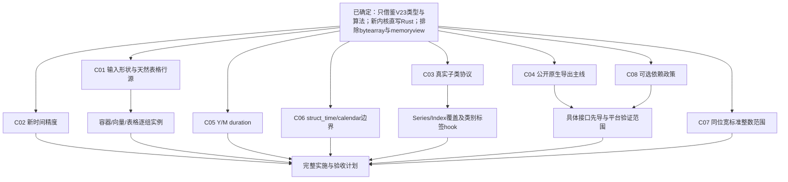

# Escape 类型扩充：V23全类型评估与接入方案讨论稿

状态：只读类型评估及判断边界调查完成；C01–C08、8.3的Decimal调整，以及G02容器、G08 record角色、分类标签、附属索引和嵌套列规则均已确认。第9节独立复核提出的C06两个边界也已获用户明确确认：struct_time六字段使用真实整数／__index__整数协议，拒绝浮点截断与负分量；非负但日历／钟面越界的值仍交MySQL判断。其余类型方案保留；依赖版本、实际导入与GIL／NoGIL安全仍待技术验证。已形成[72小时实施计划](../tasks/escape-type-expansion/plan.md)，新增24小时全部用于性能优化，并持续处理未明；当前Goal已获用户正式启动，实施状态／预算／具体授权见本地计划；下文只读评估保留为当时事实，不当作运行验收。确认方案不等于实现验收。

## 1. 目标、依据和已确定边界

目标是完整评估冻结Experimental V23已经支持的输入，按可以共用的读取、值编码和结构适配方式归组，提出接入当前SQLAero Escape的具体方案；完成本轮评估后再与用户讨论。**用户已再次明确：Experimental的入口是Python对象，输出是Python str，本次只借鉴其类型范围、算法逻辑和经验，不照搬实现或输出架构。** 这里的“支持”指作为execute／executemany的参数，经Escape直接进入Rust请求缓冲；不增加逐值Python SQL字符串、Python行字符串或必须先返回Python str的中间接口。

- 当前交付：本工作树HEAD `4433cdac72c8848e5de6191a6a491b0d33ee0c18`；产品C16 `02b9ecb525266bcccb33b25f5d4f39ceaae8dc92`，版本0.2.0b4，PyO3 0.29.2。
- 冻结参考：`experimental/rust/version.json`的 `rust-reference-lifecycle-v23-20261020`，启用polars-bridge，native SHA256 `6d7ede93b2bf6cbd8eaee42a9aa89dcc5092a3bf69378a95b37f718ec155fb30`。本轮已重算native及manifest列出的19份源文件，全部与声明一致；manifest自身SHA256 `5245b0e606f3f558e424176834c7fafc38812da689c472087a49b6ce281d11df`。没有加载该扩展或复算其历史成绩。原始历史计时已按用户旧授权删除，保留总结不等于新实测。
- 长期规则：[Python边界扩展契约](python-boundary-extension-contracts.md)，特别是E01–E12及共同的GIL／NoGIL规则；当前具体值和绑定契约沿用已确认D07／D08。
- 历史清单：[原未来类型文件](/Users/jef/ResilioSync/code/SQLAero/docs/Rust内核优化方案总结与未来类型支持清单.md)是0.2.0a1时的资料，只作待核对索引，不直接当作C16能力或本次语义规范。
- **明确排除：bytearray及其所有子类、memoryview。** 不以bytes隐式转换、迭代整数、NULL或其他容器路径重新接入。内部使用受控buffer接口不等于公开支持memoryview输入。
- **不因实现方便静默改变已确认语义。** 当前有限浮点保源值、负零、非有限数NULL、准确整数／Decimal、aware datetime的UTC规则、字符集／NO_BACKSLASH_ESCAPES、错误主因、期限／资源、确认前缀与旧结果规则保持。用户要求的重新评估见第9节；发现真实问题可以提出修改，但未获决定前不把建议写成已批准政策。
- 不新增V23本来没有的ndarray／DataFrame任意子类、通用结构化数组、任意PyArrow标量或第三方自定义扩展存储。不把名称相近、相同字节宽度或实现某个Python方法当成类型已受支持。

当前产品的支持事实取自 [typing.py](../python/sqlaero/typing.py)、[input.rs](../crates/sqlaero-python/src/input.rs)及[binding.rs](../crates/sqlaero-python/src/binding.rs)：精确None／bool／int／float／Decimal／str／bytes／date／datetime／time／timedelta和精确list／tuple；Python类型发现与拥有关系都在绑定边界。V23旧文档中的bytearray条目已被后续明确删除决定覆盖。

## 2. 本轮评估的时间与方法

总预算120有效分钟，不继承24小时修复或其他已结束项目余额。首个可靠时钟为2026-10-31T16:30:58Z（北京时间11月1日00:30:58）；此前必要读取保守计3分钟，等待用户确认不计。连续工作且无暂停时截止2026-10-31T18:27:58Z（北京时间02:27:58）。并行工作不重复相加。

| 步骤 | 交付 | 目标分钟 | 当前状态 |
| --- | --- | ---: | --- |
| A00 | 范围、排除项、身份与资料适用范围 | 5 | 完成；已核当前源，重算V23 native及19份manifest源文件；不等于运行验证 |
| A01 | V23实际类型／dtype／结构清单 | 30 | 完成；两个只读事实核查结果已交叉核对，类型／dtype／布局／子类边界均有源码定位；未运行旧包 |
| A02 | 当前Escape数据流与稳定边界 | 25 | 完成；Rows／Row／Visit、writer及Cursor消费已对应；一次通用接线与按类型适配边界分开 |
| A03 | 逐组具体接入方案与安全／性能取舍 | 35 | 完成；G01–G14均有路线、拥有边界、成本与验证方向；未测速度不填写倍率 |
| A04 | 全清单覆盖、矛盾、例子及未决问题复核 | 20 | 完成；两组事实交叉核对已回收并纠正；覆盖索引、具体例子与C01–C08已对应 |
| A05 | 本文件读回与共同讨论入口 | 5 | 完成；35个本地引用均存在，正文已读回；进入讨论，不启动实施 |
| A06 | 用户新增的客户端／MySQL判断边界调查 | 原余额内目标30 | 完成；第8节调查已交付，Decimal及struct_time修订已确认；其他主动政策保持 |

本文件同时为本轮唯一状态记录。30分钟检查点按已用3分钟接续：16:57:58Z、17:27:58Z、17:57:58Z；若提前交付则记录实际用时，不为花余额增加调查。每次自查核对是否仍直接缩小类型／实现方案缺口。无新信息的同一路线停止，必要的真实歧义留给讨论。

采用grill-me所指向的grilling，完成事实核查后按依赖关系提出可独立决定的问题；用户要求先完成评估，再开始共同讨论。Budget用于范围和时间，Rust用于所有权／错误／分派，API skill用于稳定契约。Skill不替代用户的值规则，也不自动批准实施。

## 3. 当前实现可以复用什么，需要先整理什么

### 3.1 当前真实数据流

当前网络已经消费自有请求字节；新输入不应导致网络或事务认识NumPy／Pandas／Arrow／Polars。当前Row仍只保存Python对象，Sequence只认识精确list／tuple；仅给ScalarTypes增加分派不能完成数组／表格的批次与列结构适配。

### 3.2 建议的稳定Escape内部契约

在Escape域内，将“Python对象必须如何安全读取”与“这一行有多少参数、怎样将某个值写入字节”分开。准备态可使用有限枚举或局部专门reader；不是为所有单元生成通用Value树。

- 输入准备一次取得类型／维度／列策略和有效拥有者；迭代按行、块推进。
- 行视图提供宽度、逐位置原生写入及共用错误位置；数组／列式行不先转Python行tuple。
- 先用已知shape／列数核对参数行宽；不匹配时不读取各单元或先执行用户值转换。schema核对是类型准备，不能变成整份值预扫描，也不能根据SQL位置数反向改变输入形状。
- `Row.bind`／`bind_fragment`继续复用模板位置、真实Context、限额和writer；值的转换只在必要边界发生。
- `Rows.at`仍能处理上下文实际变化后的rollover重编；未变化时复用已编码Rust字节，不重复执行转换钩子。dict／set／stream等非随机访问源不能从头重播：保留当前溢出行及其必要拥有者，或当前不可变chunk的逻辑行视图，实际重新写入时重取安全视图。最多保留需要重编的当前行，不缓存整个历史批次；不能用重新遍历已发送前缀来模拟随机访问。
- Python／capsule／provider拥有者留在绑定边界；纯Rust核心和网络只接受原生值／同步有效视图或自有字节。释放可能回调Python的外部拥有者时仍在正确attached边界。
- 初次整理若把准备改成可失败，需要对Cursor的构造调用做一次统一错误传播接线；不能把“一次通用接线”扩成每新增一个Python类都修改Cursor。是否能原位保持现Rows接口，在实施的最小切片核实，不虚称当前接口已天然覆盖全部类型。

关键实现位置：[Rows与Row](../crates/sqlaero-python/src/binding.rs:77)、[Visit](../crates/sqlaero-python/src/binding.rs:289)、[Cursor唯一消费入口](../crates/sqlaero-python/src/cursor.rs:222)、[原生scalar writer](../crates/sqlaero-core/src/bind/scalar.rs)、[原生Blocks](../crates/sqlaero-core/src/bind/batch.rs:173)。当前Cursor只在已保留的overflow行上调用`rows.at(index)`；这个内部契约可以推广为“重新取得当前保留行”，不必为支持stream而新增一个通用可回放批次框架。

### 3.3 不能从V23直接继承的假设

1. V23是旧GIL构建，PyO3 0.28.2；attached／旧GIL保护区不自动成为NoGIL下的互斥或外部存储保护。
2. V23按列式输出UTC，但其Python aware datetime／Timestamp标量可直接读钟面；不能统一宣称V23所有时间路径都实施UTC。新版保持自己的已确认规则。
3. V23旧pyo3-polars 0.27.0依赖PyO3 0.28，不可直接拼进当前固定0.29.2；Rust桥和Python运行库的ABI版本必须另核。
4. 原生数据地址、只读flag、对象强引用、Rust借用guard各保护不同事实。不能据其中一个就推断其他线程不会修改／resize底层存储。
5. V23有Python最终SQL字符串及items结果布局；新版根据当前数据契约重用算法，不迁移其输出中间层或按字符串首字符猜结构的机制。空数组特殊占位、偶然穿过的未知dtype、历史格式差异等只记录为参考边界，不自动建设兼容补丁。比较性能时分别说明V23返回str与新版写Rust缓冲／完整execute的计时边界，不为“公平”强迫新内核生成额外Python str。

### 3.4 代码组织建议：只整理实际需要的Escape边界

把当前`binding.rs`中的Python Sequence识别／遍历逐步收归Escape适配域，类型表只保留一份；绑定层只消费已准备的行宽、当前值写入与batch事实。可以按实际依赖拆成`input`下的scalar／sequence／numpy／pandas／arrow／polars子模块，外加共用shape／visit能力；不预先创建空文件或一套注册插件框架，不为每个具体类一个模块。

当前核心`bind/scalar`／`writer`属于原生值编码能力，新类型只应按确切需求扩充准确时间／Decimal等原生入口，不把Python类型名传给它。SQL扫描、Blocks、事务、网络、Decode不加输入类型分支。初始化可失败或天然表格batch事实需要的一次通用接线单独记录和保护；此后新增同契约类型不再修改外链。

类型／API缓存由模块拥有，复用M03已经验证的“准备完整候选、短边界发布、落选者锁外释放”思想；不在持Rust缓存锁时import依赖／执行Python／释放可能回调的最后引用。依赖缺失与实际provider错误分开，真实MemoryError／KeyboardInterrupt等不得为了回退另一reader而吞掉。

公开`EscapeInput`／pyi要同步新增类型，但不能为了构造运行时类型联合而在`import sqlaero`时无条件import所有第三方库。静态存根与可选类型引用保持清晰，运行时仍由唯一Escape适配器验证；不能用任意Any回退冒充全部输入都得到静态保证，嵌套list[Any]已有的限制也应说明。无可选依赖环境的导入与普通接口类型检查应保留为必要验证。

## 4. 分组评估

本节的“V23支持”来自固定源码静态分派，不是本轮运行验证；已确认值／接口政策以第5节为准，具体实现路线仍待实施验证。既有C16运行证据只证明既有能力，不证明下列入口已经可用。相同reader分组不等于同名所有dtype自动支持。

| 组 | 完整输入族／能力 | 主要复用 | 本次需要做的事 |
| --- | --- | --- | --- |
| G01 | 当前11类精确标量及精确list／tuple | 当前scalar／text／binary writer和Visit | 作为保护基线，精确热路径优先保持 |
| G02 | dict、dict_keys、dict_values、dict_items、set、frozenset、range | 当前结构遍历、路径、限额和writer | 新增安全序列／视图适配及根／行／单元角色 |
| G03 | time.struct_time | 当前原生数字／缓冲写入能力 | 原始六分量的安全格式化入口，不能当tuple拆开或伪造已验证Date／Clock |
| G04 | str／int／float／bytes、四类日期时间、Decimal、list／tuple／dict／set／frozenset的真实子类 | 精确类型writer、已有Python协议和遍历 | 冷分派、必要转换、原对象递归身份；不接受任意duck type |
| G05 | NumPy八类定宽整数、float16／32／64、bool_、str_、bytes_ | 当前整数／浮点／文本／二进制writer | 原生标量读值与类型映射；没有逐值Python字符串 |
| G06 | np.datetime64／timedelta64、pd.Timestamp／Timedelta及各库时间列 | 当前时间writer、V23的整数单位和calendar算法 | 统一时间语义、倍率、精度、UTC和有效值域；NaT分来源 |
| G07 | 精确np.ndarray，1D／2D及17个既有逻辑kind | G05／G06、当前Row／Visit | 元数据准备一次，typed块／真实stride，Object逐值拥有 |
| G08 | 精确np.record | 共用Visit、字段顺序、循环保护 | 字段序列适配；不等于结构化ndarray或generic void |
| G09 | pd.NA、pd.NaT、各列式来源的null | 当前NULL writer | canonical身份／validity，不用泛化isna猜每个对象 |
| G10 | pd.Series、pd.Index及已有真实子类 | NumPy／扩展列reader | 一维入口与存储分流；保留索引组成值、不编码标签 |
| G11 | 精确pd.DataFrame | 各列reader与共用Rust行组装 | 按列取得存储，按行写请求；不先df.values混成object表 |
| G12 | 七类Pandas独立扩展数组 | G07／G09／G13、共用分类resolver | 为同一存储开放根入口，无第二套值编码 |
| G13 | PyArrow Array／ChunkedArray／RecordBatch／Table／DictionaryArray | 共用原生列reader、writer和行组装 | 标准capsule／stream导入，明确递归dtype白名单 |
| G14 | 精确Polars Series／DataFrame及下列既有dtype | G13列reader、Object visitor、共用行组装 | 公开原生导出主线与可维护桥接评估，Object单独按值读取 |

### 4.1 G01：保护现有精确类型，复用值writer

当前None／bool／int／float／Decimal／str／bytes／date／datetime／time／timedelta已经支持，list／tuple结构也已有实现。本组不重写一遍；新增类型只提供准确的值／视图，交给相同writer。

- int保留i64／u64快路及已批准65位精确边界；不能把NumPy整数统一变f64。
- float16／32准确提升到f64后，复用当前有限值formatter和e0数值类别；负零保号、NaN／±Inf为NULL。原生f32→f64不是十进制四舍五入。
- Decimal保持准确系数／指数与65必要位、非有限NULL；用户已确认取消独立30必要小数位拒绝，由MySQL处理目标scale，见8.3。C16产品仍有旧30位检查，尚未修改。Arrow Decimal256不因此放开任意必要位或指数展开。
- 文本继续按当前连接的编码和NO_BACKSLASH_ESCAPES写入；二进制继续当前CAST十六进制表示。V23的_binary文本／surrogateescape表示不迁移。
- aware datetime沿当前UTC与会话确认规则；time沿当前钟面规则，timedelta沿完整带符号总小时规则。

**性能影响：** 原生writer复用可免去新的Python格式化与结果str创建；新增冷分派若进入每个精确标量的热帧，也可能使原类型变慢。识别顺序保持精确常用类型在前，扩展／真实子类在后；不能假定“只加分支”没有编译布局成本。当前48项已接受退步与106项U保留原身份，不改成新功能的PASS或未来代价授权。

### 4.2 G02：额外容器和字典视图

**已由用户统一确认：** dict／dict_values／dict_items按顺序提供值，dict_keys提供键；set／frozenset使用实际迭代顺序、不排序；range按起点／步长推进。套用C01的根／行／嵌套角色，不按dict key匹配SQL列、不变命名参数、不自动JSON化。实现不照搬V23的Python中间结果或整份dict复制。

V23事实定位：[containers.rs](../experimental/rust/src/containers.rs:16)、[容器归一化](../experimental/rust/src/containers.rs:210)。

| 输入 | 实际逻辑值与顺序 | 建议实现 | 独有边界 |
| --- | --- | --- | --- |
| dict | 插入顺序的values，keys不作为SQL值 | 支持精确dict的有拥有引用的遍历，再复用Visit／RowSource | 不按SQL列名取键、不变命名参数；键对象用于必要哈希／容器逻辑，不生成SQL |
| dict_values | 视图中的值序列 | 受控迭代，每次取得当前强引用，保留视图／底层拥有关系 | 不是整批原子快照；不跨Python回调持借用槽 |
| dict_keys | 视图中的键序列 | 同上，但键作为实际SQL值进入Visit | dict本体忽略键不代表keys视图也忽略键 |
| dict_items | V23先dict归一化再转values；实际目标是原顺序的值 | 新版优先评估公开`view.mapping.values()`或等价的安全值迭代，避免复制整份dict；统一交值reader | 不是两列(key,value)；如果最终确实要求构造器副作用，才保留必要归一化，不把旧步骤当必须照搬 |
| set | 元素序列，使用该对象实际遍历次序 | 标准迭代器取得拥有元素，再逐值写入 | 不排序、不承诺跨进程稳定；不能依据集合顺序保证业务行顺序 |
| frozenset | 同上，容器自身不可变 | 同一set族reader；元素仍各有自己的拥有规则 | 不可变父容器不等于元素无可观察转换 |
| range | 按start／step的整数序列 | 首先安全native迭代；若值得优化，准备start／step／count后以受检Rust整数推进 | 不预先list化；大整数仍受当前数值政策；count／尺寸溢出明确报错 |

建议用一个有限的Sequence／Iterator适配处理这一组，不为每类另写many和递归引擎。根／参数行／嵌套值共享显式角色；字典值中有list、tuple、array等时，结构交给同一Visit与形状规则。

**GIL／NoGIL：** 优先复用当前PyO3的强引用及受控迭代接口。不要直接采用V23的PyDict_Next借用值循环；不能在持字典保护且还保留borrowed值时执行任意转换、信号或析构。固定PyO3的`dict.iter()`文档明确存在并发修改导致panic的路径，[源码](../third-party/pyo3/src/types/dict.rs:185)；因此不能把“高层API”本身当成完整失败契约。可选基线是CPython迭代器返回拥有值，原RuntimeError正常传播；在有明确收益时再做短保护下的有界强引用块，而非整批复制或持锁编码整个嵌套树。

**可量化成本：** N个元素仍需N次逻辑读取和N次值编码；不新增N个SQL str、不新增整个list副本。对于canonical dict_items，官方公开的[dictview.mapping](https://docs.python.org/3/library/stdtypes.html#dictview.mapping)可取得底层字典只读代理，进而读取values；这给出常数级准备、避免旧O(N)dict归一化的候选路线，动态视图不是整批快照，实际读取仍须安全。set排序将新增O(N log N)工作，方案不采用。range原生推进若实现可减少N个临时Python int，实际收益必须测量。

**必须验证：** 视图空／非空、dict和list／tuple交叉循环、重复但非循环引用、mutation错误及后续可恢复、未支持叶子位置、many／itemize四组合、读取期间中断、早失败保旧结果、晚批失败保确认前缀。字典的标量键不进SQL，错误消息不调用任意key repr。

### 4.3 G03：time.struct_time

V23在普通tuple正规化与逐项遍历前截获canonical struct_time，只读前六个时间字段，见[containers.rs](../experimental/rust/src/containers.rs:437)及[struct_time.rs](../experimental/rust/src/struct_time.rs:64)。

把它视为专门日期时间标量：识别标准canonical类型，在绑定边界按真实整数／__index__整数协议读六个字段，拒绝float截断、字符串数字转换及负分量；取得准确的非负Rust分量后直接格式化到请求。保留协议原异常。复用受检的数字／缓冲写入能力，但不把未验证日历分量伪装成仅允许合法日历的Date／Clock后交给依赖合法性的算法。不要把九槽tuple当九个位置参数，不用strftime、mktime或本机时区作来回转换，不抄旧版私有descriptor偏移／type version投影。

`time.localtime()`与`gmtime()`给出的都是相应函数已经计算好的钟面；struct_time本身不足以唯一恢复时区瞬间。不依据tm_isdst／zone名称猜UTC。C06最新修订已确认：通过整数协议及非负检查后，准确写出六个分量，日历／钟面合法性由MySQL按目标类型和sql_mode判断；客户端不因2月31日、月份0／13、小时25或秒60／61预拒绝，不自动进位／NULL。字段读取、转换异常、溢出、资源和安全写入检查仍保留；不能先窄化成u8而改变值。

**成本与验证：** 一次类型准备、六次受检字段读取及非负判断，加一次原生writer；没有Python datetime／SQL str中间对象。GIL和NoGIL下均保活对象与字段。验证真实整数、__index__、float／字符串及负分量拒绝、协议原异常；对通过该边界的正常／无效日历、钟面、闰秒、超大整数、嵌套和批量，核对准确请求及服务器实际结果，确认不额外预拒绝／修复。服务器拒绝仍按真实服务端错误及批次事实处理。没有实测提速承诺。

### 4.4 G04：真实子类与转换语义

实际V23规则见[escape_subclass](../experimental/rust/src/lib.rs:1714)、[list归一化](../experimental/rust/src/lib.rs:1860)、[tuple及额外容器](../experimental/rust/src/containers.rs:394)。这里的“子类”必须是实际继承关系；不调用任意对象的`__str__`／`__int__`试探是否可以接纳。

| 家族 | V23参考做法 | 新版建议与不可省略的条件 |
| --- | --- | --- |
| str | `str(data)` | 获得正式转换后的文本，再由当前编码／转义writer处理；不把返回文本当SQL代码 |
| int | PyNumber_Long | 仅该真实家族执行约定整数转换，得到准确整数后复用当前数值writer；不走str原文拼接 |
| float | PyNumber_Float | 得到f64后复用有限性、负零和NULL规则；不跳过转换异常 |
| bytes | PyObject_Bytes | C03已确认保留必要`__bytes__`协议，转换结果在边界消费。无hook的原生基值路径须验证等价性及安全后借用；不能因此接纳bytearray |
| datetime／date／time／timedelta | 原生基类字段 | 类型识别顺序先专门Pandas缺失／时间，再datetime、date；当前UTC和time规则优先。datetime子类按本轮已确认U01使用基类日期时间字段／偏移语义，保留真正tzinfo.utcoffset协议及其原异常，不派发datetime子类自身utcoffset覆盖。Pandas额外精度另走G06 |
| Decimal | canonical Decimal构造器取得基值 | 用基类准确值，忽略子类伪造as_tuple等方法；复用当前非有限和精度政策，不受context舍入 |
| list／tuple | 对应正式构造器归一化 | 需要保留自定义迭代协议时执行一次必要转换；原对象及归一化结果都参与正确的递归／拥有关系，不能仅检查新容器身份 |
| dict／set／frozenset | 对应正式构造器归一化 | 复用G02的值语义；保留转换失败，不为每个自定义类专门登记。正式构造器可能走原生快路，不承诺强制触发全部覆写方法 |

这是十四个基类家族的能力，不是可枚举全部用户类名。IntEnum／StrEnum、namedtuple可按真实祖先进入对应族；bool、range和内建字典视图没有因此增加任意用户子类支持。UserList、UserDict、deque、generator及一般Mapping／Sequence不属于这轮V23范围。

C03已确认保留本组明确的正式转换协议，用冷回退和按需正规化保护精确类型热路径；不能把改变用户可观察的hook说成只改实现。bytes子类必要的`__bytes__`协议结果是边界对象，与逐值Python SQL字符串不同。

**NoGIL与成本：** hook可执行任意Python、重新进入库或改变其他输入，调用前不保留可能失效的借用视图／容器锁。转换一次、复用准确结果；普通标量子类多一次协议调用和必要拥有，容器子类可能有一次O(N)归一化，不能承诺与精确基类等速。必要hook不可缓存成跨行答案；原MemoryError／KeyboardInterrupt及普通异常原样保留。

### 4.5 G05：NumPy数值、文本和二进制标量

实际精确类白名单在[numpy_scalar.h](../experimental/rust/include/numpy_scalar.h:713)，原生半精度提升在[numpy_native.rs](../experimental/rust/src/numpy_native.rs:621)。

| 类型 | 新版读取／Rust值 | 共用writer与关键边界 |
| --- | --- | --- |
| int8／int16／int32／int64 | canonical精确NumPy整数，经官方C API取得实际signed值 | i64整数writer；不调用逐值str或缩成C long |
| uint8／uint16／uint32／uint64 | 同上，unsigned保持到u64 | u64整数writer，完整UINT64_MAX不丢精度 |
| float16 | 官方原值或受检u16位模式，准确提升f64 | 当前float writer，所有16位模式中的有限、负零、非有限分类验证 |
| float32 | 原生f32准确提升f64 | 当前float writer；0.1f32不能先取NumPy短str冒充原值 |
| float64 | 原生f64 | 当前float writer；不等同于Python float精确类身份 |
| bool_（与np.bool为同一canonical类的别名） | 原生boolean | bool writer，不按int子类猜，不重复算类型 |
| str_ | 经批准NumPy文本／真实str族读取 | 当前Unicode／连接编码writer，保留必要子类协议 |
| bytes_ | 经批准NumPybytes／真实bytes族读取 | 当前binary writer，保持该标量实际bytes内容 |

**类型与别名：** `byte/ubyte`、`short/ushort`、`intc/uintc`、`intp/uintp`、`int_/uint`、`long/ulong`及`half/single/double`要按平台上实际canonical类／dtype映射，不能按名字复制一份分派。冻结macOS的`np.longlong/ulonglong`虽然64位，却不在旧reader选中的Long/ULong分派；`longdouble`即使占8字节也不是float64。C07已确认以跨平台逻辑dtype的signedness／8/16/32/64位归一，纳入这些标准同宽整数类。complex、longdouble和自定义dtype不因位宽接近而接入。

**装载路线：** 候选rust-numpy 0.29.0在依赖层与当前PyO3 0.29匹配，但其固定源码`PyArrayAPI::get`在初始化失败时仍有`.expect`，[原生API装载实现](https://raw.githubusercontent.com/PyO3/rust-numpy/v0.29.0/src/npyffi/array.rs)。因此不能仅凭能编译就采用它的所有高层入口，也不能只`import numpy`就宣称C API已可失败地准备。建议先形成模块拥有、一次可失败准备的NumPy API边界：canonical类型、API／ABI、单位metadata均验证后复用；优先使用成熟定义和公开C API，必要薄适配限于Escape，不增加进程级裸Python指针缓存。候选路线必须通过真实冷装载失败、缺依赖、API不兼容和原异常测试，才进入当前组合。

**性能与安全：** 数值／布尔标量读取是一次定宽复制，f16／f32多一次准确数值提升；不创建中间Python int／float／SQL str。文本／二进制按实际长度和已确定协议处理，canonical np.str_／bytes_可先验证是否直接复用基类内容读取，避免无意义构造普通Python str／bytes；真实自定义子类的必要转换不能偷偷跳过。第一次依赖发现与C API准备是冷成本，不计成每个元素成本，也不能从基准中隐去实际首次使用费用。NumPy未安装时当前标准类型仍能正常使用；真实NoGIL下核对导入NumPy前后GIL仍关闭。

### 4.6 G06：统一时间适配，保留单位、精度和UTC来源

覆盖`np.datetime64`、`np.timedelta64`、`pd.Timestamp`、`pd.Timedelta`，以及NumPy数组、Pandas／Arrow／Polars时间列。类型专有内容在此读取；日期／时长算法和writer尽可能共用。

| 输入／逻辑类型 | 读取事实 | 建议的新路径 |
| --- | --- | --- |
| np.datetime64 | i64 ticks、真实dtype单位和完整倍率；i64::MIN是NaT | NaT先NULL；Y/M为calendar起点，W/D/h/m/s/ms/us/ns用整数算法；不经Python datetime或浮点timestamp |
| np.timedelta64 | 同上；Y/M是特殊calendar单位 | 固定单位转整数时长；Y/M按C05已确认的400年周期平均秒数换算，完整应用dtype倍率 |
| pd.Timestamp | 可有s/ms/us/ns分辨率、时区和纳秒余数 | canonical Timestamp优先一次公开`asm8`保留源unit和ticks，再交相同时间reader；aware按当前UTC会话规则，不照搬旧钟面读取 |
| pd.Timedelta | 自身分辨率和潜在纳秒余数 | 公开`asm8`到准确timedelta64 reader；不用total_seconds，不先to_pytimedelta丢余数 |
| date32／date64 | Arrow日／毫秒日期；Polars Date为日 | 日期writer；有效date64必须整日，非法值不静默截取 |
| time32(s/ms)／time64(us/ns)、Polars Time(ns) | 一天内钟面ticks | 检查一天范围，写当前time语义；不是可超24小时的duration |
| timestamp／Datetime(ms/us/ns) | 物理epoch ticks，可能另有timezone metadata | 带时区列输出UTC；metadata在列准备时读，当前Context在每个真实请求边界核实 |
| duration(s/ms/us/ns) | 有效ticks与独立validity | 精确带符号时长，完整总小时；Arrow有效i64::MIN不当作NumPy NaT |

NumPy的单位转换和Gregorian era算法可借鉴[numpy_time.rs](../experimental/rust/src/numpy_time.rs:81)。需特别处理两点：

1. **不要把所有时间先乘成i128总微秒。** 源i64×完整倍率×年单位可能使总微秒超i128，即使“整秒＋小数余数”仍能准确表示。优先保持受检的宽整秒／日历坐标和分数分离。当前`Date.year: i32`及`date_body`不能直接接纳NumPy极大／负年份；需要在Escape的原生时间writer域提供准确的宽年份入口或明确值域，不得窄化／无符号强转。
2. **纳秒政策不能偷定。** V23对ns向负无穷截到微秒；Timestamp标量也会丢掉纳秒余数。当前C16只接纳微秒源，尚未为新纳秒源决定该损失。经用户追问和MySQL源码核实，C02已确认保留源精度、原生生成时间文字，将目标列精度处理交给MySQL。日期时间与TIME／带符号时长的解析路径分开核验，不把某条路径的事实扩成全部已验。

NumPy Y/M timedelta并非天然固定天数；官方把平均换算列为unsafe conversion，并说明采用400年周期平均值。[NumPy时间文档](https://numpy.org/doc/stable/reference/arrays.datetime.html)。用户已在C05明确选择平均定义：一年31,556,952秒、一月2,629,746秒；有符号ticks与完整dtype倍率均参与准确整数换算，不依赖参考日期。这里的unsafe是NumPy对非固定日历单位转换的语义分级，不是授权内存unsafe。`ps/fs/as`有效值和generic非NaT不列为V23已支持单位；NaT在其适用来源上仍可先NULL，不能把未知schema全null当作任意单位都已支持。

Pandas公开的[Timestamp.asm8](https://pandas.pydata.org/docs/reference/api/pandas.Timestamp.asm8.html)／[Timedelta.asm8](https://pandas.pydata.org/docs/reference/api/pandas.Timedelta.asm8.html)提供NumPy时间标量入口。其真实返回、aware instant、分辨率及原异常须在实施时用目标版本核验；本轮未运行，不能宣称已经替代旧路径。只访问`.value`会强制ns表示，可能人为缩小较粗分辨率可表达范围，方案不默认采用。

**可量化成本：** 列unit／倍率／timezone准备一次，之后每值读取ticks和必要整数运算；不每行查dtype或做Python时区转换。scalar可有一次公开桥接对象；数组／列内没有逐值时间标量构造。UTC Context变化仍按既有rollover机制重核。微秒精度、NaT／validity、极值、负分数、DST相邻instant和已变会话状态必须独立验证。

### 4.7 G07：精确1D／2D ndarray

只接入精确`np.ndarray`，不自动增加0D、3D+、matrix／recarray／任意ndarray子类。V23的17种array kind归并为以下reader：

| dtype族 | 共用读取与writer | 必须覆盖的独有条件 |
| --- | --- | --- |
| signed 8/16/32/64、unsigned 8/16/32/64 | 准备typed stride视图，逐块读machine值→整数writer | endian、对齐、反向／转置／零stride、完整u64、长度乘法溢出 |
| float16／32／64 | typed块→准确f64→float writer | subnormal、正负零、NaN／Inf逐值处理，不因一项非有限切换整个数组的精度 |
| bool | typed字节／布尔值→bool writer | 不把Arrow bit-packed格式套到NumPy bool字节布局 |
| datetime64／timedelta64 | typed ticks及真实dtype倍率→G06 | NaT优先、units、时间策略和极大值；不能只读typestr丢倍率 |
| S | 固定宽度bytes切片→binary writer | 仅按NumPy元素语义去padding；嵌入NUL保留，零宽明确按空bytes处理或按已定规范拒绝，不复制旧SystemError偶然路径 |
| U | 按真实字节序／对齐读取UCS4→text writer | 固定宽度尾padding、合法Unicode／surrogate政策、实际连接编码；不假定Rust char等于任意UCS4单元 |
| object | 安全取得当前PyObject强引用→共用Visit | 不对可变槽只留借用引用；支持嵌套、回调、循环、原异常，排除bytearray／memoryview仍有效 |

建议一次读取shape／dtype／strides／itemsize／byteorder并选择列／数组reader；只在同一有效拥有和访问区段复用。二维按真实逻辑坐标取值，不直接把Fortran、反向或transpose内存当C连续。非连续可用stride reader或有界Rust块，不默认`.tolist()`、全数组object化或整份连续拷贝。

**NoGIL先导是必要条件。** NumPy官方明确共享数组的并发修改／resize可导致竞态甚至解释器崩溃，object dtype在NoGIL下尤其需要保护。[官方线程安全说明](https://numpy.org/doc/stable/reference/thread_safety.html)。`PyReadonlyArray`主要约束参与同一借用协议的Rust读写者，并不自动阻止所有Python／native别名；[其源码说明](https://raw.githubusercontent.com/PyO3/rust-numpy/v0.29.0/src/borrow/mod.rs)。不能以只读flag、buffer导出或复制调用本身宣称任意外部并发修改都安全。

保留现有“调用方保持输入稳定”的要求；新reader必须证明自身的所有者、受保护读取、回调／检查前释放视图和再次取得视图。未证明安全的raw快路不能进入交付；可维护的保守读取／快照路线仍需验证其上游同步前提。若无法满足现E03的完整表述，须明确报告边界并讨论，不能把不安全存储换个类型名接入。这里不承诺检测任意外部代码主动绕过提供方安全约束的行为。

**成本：** N个primitive元素从逐值Python装箱变为N个native读取和writer；连续快路的元数据工作为每视图O(1)，非连续为每值stride运算。长度、偏移、NULL、容量及累计工作检查仍保留。块拷贝若需要，复制量为处理的真实数据字节，不必扩成全数组或SQL输出树；实际块长与detach收益在小切片测量后决定。

**形状：** 一维根、二维行源及作为嵌套值的array要按明确角色处理，见C01。typed一维object数组的一项即便是tuple，也不能未经角色判断就从“一个单元”变成多列。零行、零列、0×N／M×0不能继承旧`[("",)]`占位、丢行或空字符串输出。

### 4.8 G08：np.record

参考[record.rs](../experimental/rust/src/record.rs:19)：记录标量按字段顺序迭代，各字段仍由共用分派处理；保留原record身份进入活跃路径循环保护。

建议首个正确基线使用canonical精确record的公开字段迭代／按schema次序取值，每次强拥有当前字段，直接调用同一个writer／Visit。不先构造Python tuple或字典，不把字段名发成SQL。字段dtype若后续值得优化，再准备typed field reader；不能因为是record就默认任意np.void、structured ndarray或recarray整体也支持。

本轮不把从可替换`numpy.record`名字取得一个类型就视为充分的原生布局证明；旧路径只是公开迭代，新版若开始直接读field偏移，必须另证明真实类型与dtype／buffer边界。

**成本／验证：** F个字段为F次逻辑取值与编码，无F个SQL str；字段Object／嵌套内容继续Python边界协议。字段顺序、嵌套记录、record→Object→record循环、重复非循环字段、unsupported字段、中断、原异常和资源收尾分别验证。

**已由用户确认：record采用逻辑行角色。** 根输入无论many值均为一行，itemize=True按字段顺序提供F个位置，False提供一个完整行片段；外层普通容器many=True含多条record时，每条为一行；record处于某个参数／Object列的单元内时，作为一个嵌套字段序列，不自动展成外层多列。字段名不进入SQL，也不匹配目标列名。读取字段直接写Rust请求，不先生成Python行tuple或SQL字符串；当前C16尚未接入，不把确认方案称为运行结果。

### 4.9 G09：Pandas缺失值与列式null

V23在[tabular.rs](../experimental/rust/src/tabular.rs:170)专门识别NaT／NA。新版建议在日期／数值／对象协议之前识别canonical `pd.NaT`／`pd.NA`，直接写NULL；不调用`bool(pd.NA)`、不对所有对象执行`pd.isna()`，也不按类型名就读取Pandas扩展对象布局。

| 来源 | null依据 | 不可混用的规则 |
| --- | --- | --- |
| pd.NA | canonical对象身份 | 不是所有同名类或任意NAType实例 |
| pd.NaT | canonical单例／实际NaTType策略 | 必须先于datetime子类字段读取，不能当无效日期读内存 |
| nullable数组 | 独立mask或Arrow validity | 先mask后值；无效槽中的填充值不参与数值转换 |
| NumPy temporal | 其dtype定义的NaT sentinel | 此i64::MIN规则不传播到Arrow／Polars有效时间值 |
| Arrow／Polars null | producer的validity／Null逻辑类型 | 有效NaN／Inf另按当前数字政策NULL；有效i64::MIN保持数值 |

类型发现只在相关依赖已存在／被实际使用时准备，模块持有类型和配置；普通int调用不顺便导入Pandas。失败发现不负缓存成永久不支持，之后正常安装／导入情形按明确模块能力规则处理；不为类型缓存保存输入答案。

### 4.10 G10：Pandas Series和Index

精确Series／Index及V23已接纳的真实子类是同一维度输入；Index包括受支持值构成的RangeIndex、DatetimeIndex、TimedeltaIndex、CategoricalIndex、MultiIndex等。名字不是额外存储协议：MultiIndex的逻辑元素是tuple，RangeIndex可用range／整数reader，时间索引用G06，分类索引用共用分类resolver。

建议以公开`.array`／明确`to_numpy`／Arrow导出取得实际存储，而非统一强制`.values`或访问`._mgr`／私有block布局。官方[Series.array](https://pandas.pydata.org/docs/reference/api/pandas.Series.array.html)说明它提供实际扩展存储或普通NumPy的薄包装；这给出可维护入口，但不保证所有dtype、版本与场景零复制。

| 实际存储 | 建议读取 | 复用 |
| --- | --- | --- |
| NumPy普通数值／bool／S/U／object | 公开`to_numpy(copy=False)`或已验证的ndarray取得方式；检查真实dtype、维度和拥有者 | G07；copy=False是请求，不是零复制证明 |
| naive／aware datetime、timedelta | 取得保持ticks与unit的公开时间存储，保留timezone事实；不逐值to_pydatetime | G06 |
| nullable整数／浮点／布尔 | G12的数据＋mask，或来源已是Arrow时用Arrow | 共用MaskedColumn |
| Python／Arrow StringDtype | 分别Python对象文本与Arrow Utf8 reader | G12／G13 |
| Categorical | codes＋categories，编码标签 | 分类resolver |
| ArrowDtype | 标准Arrow列导出 | G13 |

`.values`不再是精确基类必须照搬的性能假设；Pandas3优先使用公开稳定存储接口。C03已确认真实Series／Index子类保留约定的`.values`覆盖，只在冷子类路径调用一次并校验返回；不能用基类私有快路跳过它。返回的维度／长度／dtype必须核对，不按外层类名信任任意返回对象。

RangeIndex与一般Index读取相同的逻辑值。Series／DataFrame的附属index标签、Series.name及index.names不额外进入SQL值流；**Index自身作为输入时，其索引值就是待编码的逻辑值**。MultiIndex内部tuple保留一个逻辑元素的嵌套结构，不自动转成数据库多列；根参数／行形状另见C01。

**已由用户确认：附属索引不自动变成数据列。** Series／DataFrame只编码实际数据；附属index不作为额外位置，Series.name、列名、index.names与Arrow／Polars schema字段名都不生成SQL值／列映射。Index对象被直接传入时，索引组成值是该输入本身的数据，不被忽略。业务要存DataFrame索引时由调用方显式转成数据列。统一按既有位置绑定，不改变C01的行／列／单元结构。

**成本／验证：** 依存储准备一次策略，避免N次Python scalar取出。类型包装、必要mask或转换的实际O(N)费用必须计入；不是C调用就一定无复制。空、全missing、非默认索引、重复标签、存储切片、子类原异常与metadata变化后重新取视图都需要覆盖。未支持Period／Interval／Sparse不因全missing或转成object就宣称该dtype已实现。

### 4.11 G11：Pandas DataFrame

只接入精确DataFrame，不顺带开放任意子类。V23已经按列读取并用Rust组装；参考[DataFrame入口](../experimental/rust/src/tabular/dataframe.rs:688)和[共用ASCII组装](../experimental/rust/src/tabular/dataframe.rs:502)，只迁移列／行分离和缓冲复用思想。

建议步骤：

1. 一次取得行／列形状及公开按位置的列迭代；保留列顺序、行顺序，重复列名允许。index和columns标签不进入值流。
2. 取得每列实际存储拥有者，按G10／G12／G13准备ColumnReader；先列策略、后按行／块读取。不要统一`df.values`把混合列物化成object二维表。
3. RowView按当前逻辑行从各列写入对应SQL位置，或按明确itemize规则写一个完整行片段；没有Python行list／tuple，没有每单元SQL str。
4. 写当前请求或有界行块；接近真实包限额只封完整行，复用已有Blocks／确认前缀，不先生成整表SQL字符串再按字节截断。
5. 若为按列批量编码而暂存Rust字节与offsets，暂存范围必须有界并计入操作内存；优先在当前行块内复用，不能仅因V23这么做就全表预编码。

**安全细节：** 列获取和扩展协议可能执行Python；取得下一列时，不保留上一列可失效的裸视图。可先保留列拥有者，再在无Python回调的已证明区段取得／消费原生块；混合Object列的转换会重新进入Python，进入前结束其他raw借用，之后重取实际必要metadata。真正由不可变导出拥有者独立保活的Arrow buffer可用其契约复用；不能把可变NumPy对象引用误当成不可变buffer owner。

**可量化成本：** R行C列为RC次值编码；列策略准备约O(C)，不是RC次dtype查询。避免RC个Python行／单元包装和全表object复制；仍有必要的C个列对象、mask／转换、R行分隔和真实SQL字节。若源列需要转换，不能把转换排除在计时外宣称整表快路。

**覆盖：** 1×1、窄长、宽短、1000行以上；同dtype／混合／所有支持存储；重复列名；0×N、M×0、0×0；各列chunk／null／slice；nested单元；Object混入新类型；包限额、单行超限、晚行失败、上下文改变和rollback后的事实。旧性能报告不能提供新DataFrame的实测倍率。

### 4.12 G12：七类Pandas独立扩展数组

这七项在V23可独立输入，也可作为Series／Index／DataFrame存储；建议一份reader，两类入口。其真实子类、独立DatetimeArray／TimedeltaArray／NumpyExtensionArray不因功能相近自动扩大范围。

| 独立类型 | 数据／dtype范围 | 新版主路径 | 必要额外成本与边界 |
| --- | --- | --- | --- |
| pd.Categorical | codes对应categories，含-1缺失 | 公开codes／categories→共用分类resolver | 只转换实际引用标签，ordered不进SQL；code负值／越界检查 |
| IntegerArray | Int8/16/32/64、UInt8/16/32/64 | 在有界行块上公开typed `to_numpy(na_value=0,copy=False)`＋`isna()`；已有Arrow来源可走Arrow | 块级data／mask准备；可能实际复制，不把missing补0当真实值 |
| FloatingArray | Float32／Float64 | 同上，准确提升f64 | mask与有效NaN／Inf分开；没有默认新增nullable Float16 |
| BooleanArray | BooleanDtype | 同上，bool data＋mask | NumPy字节bool和Arrow位图各走自身reader |
| StringArray | StringDtype的Python存储 | 有界块的公开对象数组／拥有元素；None／NA按来源归一 | 不预生成Python SQL str；不假定返回对象全是精确str |
| ArrowStringArray | StringDtype的Arrow存储 | `__arrow_array__`到标准Arrow导出 | 依赖实际PyArrow来源，避免再次object化 |
| ArrowExtensionArray | 递归受支持ArrowDtype | 同上，G13 | 只有入口相同，不能省略dtype白名单 |

V23参考：[七类登记](../experimental/rust/src/tabular.rs:118)、[nullable存储](../experimental/rust/src/tabular/arrow.rs:720)、[分类](../experimental/rust/src/tabular/arrow.rs:185)、[文本](../experimental/rust/src/tabular/arrow.rs:815)。

**公共接口与依赖：** 普通Pandas nullable／Python字符串路径不应强制安装PyArrow；来源已为Arrow时复用其现有依赖。若实测证明公开Arrow导出比data＋mask准备更合适，可在同一ColumnReader契约下选择，但转换和导出完整计时，不按库版本维护大量不同实现。Pandas官方提供[扩展数组Arrow协议](https://pandas.pydata.org/pandas-docs/stable/development/extending.html)，这证明协议可用，不证明零复制／NoGIL安全已验。

块级准备只读取合法存储及mask，不提前执行未来行的用户转换hook或编码未来坏值；具体块长由实际内存、检查窗和成本决定，不先固定一份全列O(N)副本。原source owner可保留，库额外的转换／mask／SQL暂存应有边界，不能把结果内存限额擅自改成新的输入API参数。

### 4.13 G13：PyArrow直接输入和递归dtype

入口范围：canonical CPU `pa.Array`及V23已支持的标准具体数组类、精确`pa.ChunkedArray`／`pa.RecordBatch`／`pa.Table`；`pa.DictionaryArray`是Array家族中的专用逻辑分派。不是任意实现同名协议的对象、任意Array用户子类或任意Arrow scalar。

| 入口 | 逻辑形状 | 新版处理 |
| --- | --- | --- |
| Array | 一维 | 导入schema＋有拥有关系的数组视图，按G05／G06及下表写值 |
| ChunkedArray | 分块一维 | 每块schema一致，保持逻辑顺序；不强制combine_chunks／rechunk |
| RecordBatch | 表格 | 按schema字段位置取得列，映射共用RowSource |
| Table | 分块列式表格 | 各列维护自己的chunk cursor，不要求chunk边界相同；用有效owner保活的视图跨边界取行，导入与必要转换是否复制另验 |
| DictionaryArray | 标签值构成的一维 | 读取有效key，再解引用本chunk的dictionary；不编码物理code |

V23参考：[直接入口](../experimental/rust/src/tabular/arrow.rs:75)、[schema白名单](../experimental/rust/src/tabular/arrow.rs:1037)、[逐值编码](../experimental/rust/src/tabular/arrow.rs:1294)。建议使用正式[Arrow C Data](https://arrow.apache.org/docs/format/CDataInterface.html)／[C Stream](https://arrow.apache.org/docs/format/CStreamInterface.html)／[PyCapsule](https://arrow.apache.org/docs/format/CDataInterface/PyCapsuleInterface.html)协议及经过核对的成熟importer；不自行构造依赖私有Python对象布局的指针桥。stream按块拉取，保留当前块、schema和必要rollover拥有者，不默认收集完整stream。

| Arrow逻辑dtype | 新版共用reader | V23范围和新增实现注意点 |
| --- | --- | --- |
| null、bool | Null／bit-packed bool | mask、bit offset先准备，null不读无效槽 |
| int8/16/32/64、uint8/16/32/64 | 原生整数 | 完整位宽；无隐式float或有符号误读 |
| float32、float64 | 原生浮点 | float16不在V23此族白名单；不得因NumPy支持half自动扩Arrow |
| utf8、large_utf8、utf8_view | Utf8切片 | offsets或view布局由成熟accessor解析，连接编码仍由当前writer执行 |
| binary、large_binary、binary_view、fixed_size_binary | Binary切片 | 完整bytes，不按NumPy S裁尾NUL；零宽与空值仍有定义 |
| date32、date64 | G06日期 | date64有效值必须整日 |
| timestamp(s/ms/us/ns)，可带tz | G06日期时间 | aware metadata／UTC；i64::MIN有效值不作NaT |
| duration(s/ms/us/ns) | G06时长 | 单位／负值／极值；按C02保留源精度，由服务器决定目标精度 |
| time32(s/ms)、time64(us/ns) | G06钟面 | 一天范围；不接纳不存在的dtype／unit组合 |
| decimal32／64／128／256、负scale Decimal | 原生准确系数＋scale | 见下文及8.3：65必要位表达域保持，目标scale交MySQL；现有C16的30位检查待实施修订 |
| List、LargeList、FixedSizeList | offsets／固定宽度＋子reader | parent null不读children；子类型递归验证；不自动接ListView |
| Struct | schema字段顺序＋子reader | parent与child validity正确合成；字段名不输出 |
| Dictionary | key＋label reader | signed／unsigned8/16/32/64 key；当前chunk字典；负／越界值失败 |

**Decimal路线改进：** V23对decimal256和负scale会通过Python Decimal叶子fallback；新版无需复制这条中间对象路线。现有`num-bigint`可以承接受界的32字节有符号系数，或成熟Arrow的i256类型提供受检转换，再用当前Decimal规范化／范围政策写出。每值最多固定32字节系数及有限十进制工作，不先to_pylist整列，也不把兄弟时间／二进制列一并物化。负scale是准确补零，不是无条件拒绝；超过当前必要位／小数位范围按既定DataError。该方案是静态可行建议，尚未编译验证成熟importer的具体i256接口。

**分类共用：** Pandas Categorical、Arrow Dictionary、Polars Categorical／Enum共享“code→实际标签→writer”。只求值实际引用标签；缓存限于本调用／当前Context／当前dictionary、可证明无hook的不可变native标签。对会执行Python协议的标签，保留每次可观察转换，不缓存跨调用答案。不同chunk可有不同字典，不能拿第一块缓存解全部数据。

**已由用户确认：分类输入按实际逻辑标签编码。** Pandas Categorical及分类列／索引、Arrow Dictionary、Polars Categorical／Enum统一写实际标签，不写其物理code；缺失按来源mask／有效性规则写NULL，不能把Pandas的-1缺失约定套给所有Arrow key。标签按其真实受支持类型进入共用Escape，不统一str化、不改变行序；不同chunk按自己的字典解释。业务若要存code可显式取出编码数组再传入，不新增自动code模式开关。方案已确认，当前尚未实施。

**nested共用：** List／Array保留嵌套值，Struct按schema字段值序列；表格中各占一个单元，不自动展列或JSON化。用typed Shape／行／单元角色决定括号，绝不检查已编码字符串第一个字符来猜。生成SQL片段不代表MySQL的任意标量列能够存储嵌套数据，最终SQL／列约束仍由服务器判断。

**已由用户确认：嵌套列保持SQL序列／行片段。** List／固定Array逐元素形成SQL序列片段，Struct按schema字段顺序形成行片段，字段名不写入；单元内的嵌套仍占原来的一个参数位置，不自动增加外层表格列。缺失父单元写NULL，不读其无效子槽。与普通list／tuple及np.record的嵌套规则一致，不自动JSON化。用户若要JSON应显式提供JSON文本。SQL片段正确不代表任意目标标量列都能保存此结构；合法性由实际SQL上下文及MySQL判断。当前只确认方案，尚未实施。

**所有权：** 校验capsule名和一次消费，完整转移release责任；schema、parent、child、dictionary、slice／bit-offset和每个chunk有有效拥有者。外部callback、取下一块和释放可能需要Python附着，不将这类拥有者偷偷存入纯Rust网络任务。原始buffer长度与offset检查以标准producer／importer契约为基础，不承诺能安全消费任意伪造指针的Python对象。Device/GPU不是CPU内存，不自动接受。

成熟importer仍须核对实际使用的冷准备、尺寸和错误路径；返回Result不自动证明内部所有allocation都可失败。复用M01的原异常／分配失败契约，先约束不合法schema尺寸与当前工作范围，再导入必要数据，避免为任意元数据直接建立巨大Vec或以expect退出。只核对实际调用面，不扩大成所有第三方依赖的无界审计。

明确不自动接入：Map、Union、Interval、RunEndEncoded、任意Extension、自定义storage、Tensor、Schema根输入、RecordBatchReader根输入、GPU/device capsule、generic Arrow scalar，以及V23未覆盖的Int128／UInt128或half。标准协议能表达某类型，不等于本次已定义它的SQL值语义。

### 4.14 G14：Polars Series和DataFrame

入口仍是精确`pl.Series`／`pl.DataFrame`，不扩LazyFrame／Expr或任意子类。V23参考：[logical白名单](../experimental/rust/src/polars.rs:95)、[实际入口](../experimental/rust/src/polars.rs:1213)。

| Polars dtype | 拟接入的共用能力 | 注意点 |
| --- | --- | --- |
| Int8/16/32/64、UInt8/16/32/64 | G05／原生列reader | 不顺带加Int128／UInt128 |
| Float32／Float64、Boolean、Null | 浮点／bool／validity | 源值、负零和非有限NULL一致 |
| String、Binary | Utf8／Binary | Binary完整字节；不裁NUL |
| Date、Time、Datetime、Duration | G06 | Date日、Time纳秒一天内、Datetime／Duration ms/us/ns；aware UTC |
| Decimal | 准确i128 coefficient＋scale | 当前SQL精度政策，不经float |
| Categorical、Enum | 字典／标签resolver | 输出标签，不是code；metadata及嵌套标签递归核对 |
| List、Array、Struct | G13 nested reader | Array为固定长度逻辑list；Struct按字段顺序 |
| 顶层Object列 | Python值读取→G07 Object／Visit | 实际元素受支持才成功；不得当物理binary |

**主路线建议：** 对非Object的已支持逻辑类型，优先评估公开`__arrow_c_stream__`导出到共用Arrow reader，从而复用PyArrow／Pandas已有列逻辑，减少不同Rust Polars版本的长期耦合。官方有[Series](https://docs.pola.rs/api/python/stable/reference/series/api/polars.Series.__arrow_c_stream__.html)和[DataFrame](https://docs.pola.rs/api/python/stable/reference/dataframe/api/polars.DataFrame.__arrow_c_stream__.html)入口。优先消费capsule，不为了拿Arrow数据再先构造Python PyArrow Table。

**Object必须另作值适配。** V23在FFI导出前识别顶层Object并转公开to_numpy，再逐值common，见[Object分流](../experimental/rust/src/polars.rs:257)。固定Polars底层甚至可将对象表示导成FixedSizeBinary(8)，它不是实际bytes的序列化语义；不能据“存在Arrow stream方法”推断Object安全覆盖。方案须在导出前识别并分流：其逻辑值按公开、安全且经过NoGIL核验的对象取得方式读取。可以接受这一类必要的Python引用／对象访问，不让普通数值／字符串表走同一路径。nested Object不在V23递归范围，不自动增加。

**原生桥候选：** 旧pyo3-polars0.27.0→PyO3 0.28，与当前0.29.2不兼容；V23实际输入还有运行库1.43.2、native descriptor和version_0 FFI限制，并不是直接解包一个整体Rust DataFrame。官方[pyo3-polars0.28.0](https://docs.rs/crate/pyo3-polars/0.28.0)依赖PyO3 ^0.29、Polars ^0.55.1，是可继续核验的候选，但不等于已通过当前构建、Object语义或NoGIL。若公共Arrow主线在实际工作量下明显受限，可用一个有限先导比较新桥的导出／拥有／编译成本；可靠收益足以抵消版本耦合才采用，不维护两套长期全量Polars引擎。

**成本：** 标准Arrow导出通常以schema／chunk／buffer拥有交接为主，实际是否复制须验证；native桥也不等于O(1)整个DataFrame解包。若每列有一次Python导出，冷成本约O(C)调用；N个值由native reader写请求。Object路径可能有O(N)次Python取值或必要对象数组，单独报告，不能用它否定其他列的原生快路，也不能隐去它的成本。

## 4.15 可共用的列能力与统一行组装

建议只有一组面向原生存储的ColumnReader能力：Signed、Unsigned、Float、Bool、Utf8、Binary、Temporal、ExactDecimal、Null、Masked、Dictionary、List／FixedArray、Struct、PythonObject。它是按列准备的少量策略，不是给每个单元生成enum盒子／完整Value树；Rust泛型、有限enum与函数指针的具体选择以小规模代码与测量决定，先不建立通用插件框架。

| 来源 | 取得storage的边界 | 进入同一个能力 |
| --- | --- | --- |
| NumPy | exact数组／scalar的官方API与有效拥有区段 | primitive／Temporal／S/U文本／PythonObject |
| Pandas | 公开列／ExtensionArray接口；不读私有manager布局 | 同一NumPy／Masked／Dictionary／Arrow reader |
| PyArrow | 标准capsule／stream与成熟importer | 同一primitive／nested／Decimal reader |
| Polars | 公共原生导出或经验证兼容桥；Object先分流 | 同一Arrow reader或PythonObject |

共用行组装只处理“第r行第c个单元怎样写入当前请求”，不认识Python库类名。全量SQL字符串、per-cell Python str、Python行list／tuple均不是必要中间层。列式源可以在有界行块内编码以兼顾局部性，但不能为了复用旧整表拼串路径突破请求内存／中断限额。

长单元同样受累计工作约束：不能只每若干行检查一次信号，却让一个巨大Utf8／Binary／nested单元不可中断。复用当前按字节／元素计量、期限与真实容量检查；到可能执行Python的检查点先结束不可跨回调的raw视图，再按拥有契约重取。原生列writer不把formatting error路径中的Python操作藏到pure Rust核心。

同一类型还可能出现在Object数组、分类标签、嵌套list／struct或np.record字段；均回到共用Escape分派，排除项、精度、UTC、错误位置和循环保护不另写一套。

根Series／array／record及其底层存储身份需要参与恰当的活跃路径保护：Object元素回指原Series或原ndarray时，不能因适配成新视图就丢失原identity。共用深度／循环规则按逻辑结构计数，正常重复引用仍允许；schema递归与数据遍历各有有界工作，不默认全树预扫描。

## 4.16 用来讨论的具体例子

以下是拟议契约的说明，**不是本轮实际执行输出**。Rust请求中的片段是native字节，不是需要交付给Python的str；整条SQL效果还取决于模板、表结构和服务器。

| 输入／逻辑数据 | 拟议值或结构 | 要说明的取舍 |
| --- | --- | --- |
| `{'a':1,'b':'x'}`、同源`dict_values`、`dict_items` | 按顺序的值1和文本x | dict_items不变成两个(key,value)列；新版可避免旧整dict复制 |
| 同源`dict_keys` | 文本a和b | 该入口的键确实是值，不沿用dict本体忽略键的规则 |
| `range(3)` | 0、1、2 | 有界推进，无需先list化 |
| `time.gmtime(0)` | 六字段钟面1970-01-01 00:00:00 | 不把9槽拆成参数，不额外作时区转换 |
| int子类底层值7，正式`__int__`返回9 | C03已确认编码准确整数9 | 直接读基值将改成7，属于行为差异 |
| float32的0.1 | 源值准确提升后约0.10000000149011612，交当前float writer | 不把NumPy显示0.1当成已经准确保留源浮点值 |
| raw ticks=3，单位D、倍率2的datetime64 | epoch后6天，即1970-01-07 00:00:00 | 倍率必须完整参与，不能仅按D处理3天 |
| datetime64／timedelta64的NaT，pd.NaT，pd.NA | SQL NULL | 各自按实际来源识别，不做通用字符串猜测 |
| `pd.Series([1,None],dtype='Int64')` | 有效整数1与NULL | 不先把整列变float，不把mask填充的0写成真实值 |
| 根`pd.Index(['a','b'])` | 索引值a与b | 与DataFrame附属index标签不编码的规则区分 |
| dictionary keys `[1,0,null]`，labels `['a','b']` | b、a、NULL | 编码标签，不编码1和0；当前chunk字典各自有效 |
| Struct字段依次`x=1,y='a'` | 一个按字段序的嵌套单元`(1,'a')` | 不带字段名，不自动JSON或增加表列 |
| binary内容`b'a\x00'` | 当前binary writer保留两字节 | Arrow／Polars Binary不套用NumPy S的padding规则 |
| Object单元含`bytearray(b'a')`或memoryview | 到达该有效值时按不支持类型拒绝 | 不通过第三方容器隐式重新开放排除项 |
| 一维Object数组的一项为`(1,2)` | 一项嵌套单元 | 与普通many行容器的拆列角色分开，见C01 |

最终逐类型正确实例在用户决定后原位收敛，不保留互相冲突的选项作为实施规范。

## 5. 已确认的八项共同决定

C01、C03–C08已由用户确认；C02经后续解释、MySQL文档与源码核实后，用户明确同意源精度保留、交由MySQL处理。八项均已确认，以下只保留最终政策。第8.3节Decimal修订及C06的struct_time最终边界也已另行确认；8.6其他主动政策保持原约定。完整实施预算已确认为72小时，安排见[正式计划](../tasks/escape-type-expansion/plan.md)；确认方案／预算不等于授权实施或公开发行。

### C01：根输入的形状和many／itemize

**已确认：** 继续保留普通Python容器当前开关规则；**二维ndarray和表格有明确二维schema，作为天然行源；一维typed列保持其逻辑单元，不按某个Object元素恰好是tuple再拆列。** 不从V23的Python list／tuple返回类型推导新内核结构。

| 输入／位置 | 已确认解释 | 示例 |
| --- | --- | --- |
| 普通list／tuple及G02值序列，根many=False | itemize=True为一行多个位置；False为一个完整片段 | 现有`(1,2)`配两个%s，或itemize=False配单个%s，保持 |
| 普通值序列，根many=True | 每元素为一行；itemize=True时已有行容器可拆位置，False保整行片段 | 现有`[(1,'a'),(2,'b')]`保持 |
| 一维typed向量，many=False | itemize=True为一行N位置；False为一位置序列片段 | `np.array([1,2])`配SELECT %s,%s；False配IN %s |
| 一维typed向量，many=True | N行，每行一个逻辑单元；Object内部list／tuple作为该单元的嵌套值 | Object列`[(1,2),(3,4)]`不因元素外形变成两列 |
| 二维ndarray／DataFrame／RecordBatch／Table，根输入 | R个逻辑行；itemize=True每行C位置，False每行一个完整行片段；many不抹掉二维结构 | `execute('INSERT ... VALUES (%s,%s)', frame)`可产生两行；False配VALUES %s按原模板处理 |
| 数组／结构放在普通参数单元内 | 是一个嵌套SQL值片段，不把它升级成外层批次 | `args=(np.array([1,2]),)`配IN %s，保一位置 |
| 零长度typed向量／零行表格根 | 沿当前many根空集合的零位置规则，无位置模板执行一次，有位置则不匹配；schema仍核对。普通容器仍按前两行及当前规格 | 不照搬旧空str或`[("",)]`占位 |
| 非空表格R×0 | R个零参数行，不丢行；由模板位置规则决定合法性 | 无位置SELECT模板可执行R次；有位置拒绝 |

需要把`source.is_batch`等已归一化结构事实接给模板准备；当前Cursor `Prepared::new`仅按`many&&itemize`选择batch compiler，不能假装无需任何通用接线就能得到表格合并。接线消费结构标记，不识别Python类；不根据SQL有几个%s猜维度。

### C02：保留源时间精度，目标精度由MySQL决定

**已确认：** 对新纳秒来源准确读取原值，Rust writer直接生成含必要小数位的时间SQL文字，最终舍入／截断及目标列检查交给MySQL。现有Python微秒来源保持原输出。不同来源的同概念使用同一规则；不先floor到微秒，不因存在纳秒余数新增DataError，不默认增加精度策略开关。

1微秒等于1000纳秒；MySQL原生TIME／DATETIME／TIMESTAMP最高存储精度为6位，但这不等于发送9位小数文字就必然报错。MySQL8.4／9.7的DATETIME解析都读取微秒之后的数字作为舍入信息，默认舍入，开启`TIME_TRUNCATE_FRACTIONAL`则截断。[8.4小数秒规则](https://dev.mysql.com/doc/refman/8.4/en/fractional-seconds.html)、[9.7小数秒规则](https://dev.mysql.com/doc/refman/9.7/en/fractional-seconds.html)、[8.4 DATETIME解析](https://github.com/mysql/mysql-server/blob/mysql-8.4.0/mysys/my_time.cc#L625)、[9.7 DATETIME解析](https://github.com/mysql/mysql-server/blob/mysql-9.7.0/mysys/my_time.cc#L634)。

| 输入与操作 | 最终契约／预期 |
| --- | --- |
| 源时间`.123456789` | Rust请求保留该小数，不先变成`.123456` |
| 正常DATETIME字符串路径写DATETIME(6)，默认模式 | 按已核源码预期`.123457`；实施时核验实际服务 |
| 同一值，TIME_TRUNCATE_FRACTIONAL模式 | 预期`.123456`；最终行为由服务器执行 |
| 源时间`.123456000` | 准确写出等值时间，可以省略无意义尾零；不改变实际值 |
| NaT／null | 按来源准确识别后仍为NULL |
| 目标列DATETIME(3)或未写fsp | 由服务器进一步按列精度处理，不查询目标列来预判 |

Rust仍负责准确单位／倍率、UTC、各来源自身定义的分量规则、NULL和安全写入；struct_time以C06及第9节已确认澄清为准，不把旧的本地日历拒绝经本句重新带回。不生成Python SQL str，不强制CAST成DATETIME(6)，不为这个决定额外监控sql_mode。新writer保留分离整秒与整数小数／位数，不能先落进当前仅microsecond字段再补三位零。负epoch分解成日历／非负小数时所需的整数分解，不等于预先降低精度；带符号duration保留原符号与准确分数。

**仍需定向验证的实际边界：** DATETIME与TIME不是同一个解析器。8.4.0／9.7.0的TIME字符串分支静态可见使用微秒后扫描的末位作舍入提示，与DATETIME使用首个超出位不同；例如`00:00:00.123456499`有必要核对实际结果，不把DATETIME路径的9位预期直接套到负时长。实施先导仅覆盖两版实际服务的正负时长、7–9位舍入边界、跨秒／日进位和两种sql_mode；当前未运行，不将可疑分支记为已复现缺陷。[8.4 TIME解析](https://github.com/mysql/mysql-server/blob/mysql-8.4.0/mysys/my_time.cc#L787)、[9.7 TIME解析](https://github.com/mysql/mysql-server/blob/mysql-9.7.0/mysys/my_time.cc#L803)。若证实服务器边界不满足最终规则，再据真实结果决定最小方案；局部问题不停止其他类型。

**成本：** ns源相比6位时间文字最多多写3个ASCII字节／值；需要整数分解与位数格式化，服务端仍有解析成本。没有额外通信／全列扫描，不经float或Python中间时间／SQL字符串。不能据此承诺必然提速，实际成本在实施后计入正式测量。

### C03：新子类的值来源与协议

**已确认：** 按G04定义一套**真实继承族＋明确的必要转换**，保留已约定的可观察hook和原异常；精确基类保持快路。int／float正式转换后只交typed数值writer；str／bytes正式转换后再编码。Decimal按基类准确值，日期时间遵守当前UTC规则。不是开放任意自定义对象的转换协议。

Pandas精确Series／Index优先用公开实际存储接口；其真实子类保留`.values`覆盖，只在该冷子类路径调用一次并校验返回，不用私有读取快路跳过它。不采用统一忽略覆盖的基类存储政策。

### C04：Polars主线与长期依赖

**已确认：** 以公共Arrow原生导出＋共用ColumnReader作为普通列主线，Object在导出前按值分流；兼容当前PyO3的新版pyo3-polars仅作为必要时的小先导候选。不根据旧“Rust库→Rust库”概念宣布某桥一定最快。

先导必须同时核对：无PyArrow安装时是否仍能用Polars公共capsule；Categorical／Enum及nested schema；Object不可误当binary；真实NoGIL不强制开启GIL；导出／clone／release全成本。没有这些证据就不锁定一组看似匹配的新依赖版本。

### C05：NumPy Y/M timedelta

**已确认采用平均定义：** 非NaT的Y/M duration按400年Gregorian周期平均换算，一年31,556,952秒，一月2,629,746秒。准确整数计算`有符号ticks × dtype倍率 × 对应秒数`，不经float、不根据本机当前日期改变结果。平均一年等于12个平均月；不能描述成某个实际日历月／年的准确间隔。

Y/M datetime仍按日历起点解释，不套平均时长；NaT仍先NULL。年月平均定义与C02的源精度保留政策分开应用，不相互替代。

### C06：struct_time按整数协议读取非负六分量，日历／钟面合法性交MySQL

**最新已确认：** 年／月／日／时／分／秒使用真实整数／__index__整数协议，拒绝以int()将float静默截断，也不将字符串解析成字段整数；协议失败保留原异常。六个字段均拒绝负值，避免符号被MySQL宽松分隔符语法误解释。通过此表示边界后，由Rust直接写为安全的日期时间文字；客户端不因日历无效、月份0／13、小时25、秒60／61等非负值预先拒绝。由MySQL依据实际SQL目标类型及sql_mode决定接受、转换、告警或错误。拒绝任意字符串作为原始SQL，不自动进位、修复、NULL、mktime规范化，也不猜测时区。不创建Python datetime或逐值Python SQL str。

| 输入情况 | 已确认行为 |
| --- | --- |
| 合法六分量 | 准确写入当前Rust请求，交MySQL执行 |
| 2024-02-31 12:00:00 | 写出对应文字，由MySQL判断；不变成3月2日或NULL |
| 非负的非标准月／钟面／闰秒分量 | 保留准确整数分量写出，由MySQL判断；不按u8窄化或本地日历规则预拒绝 |
| 任一字段为负整数 | 客户端拒绝并给出共用位置诊断，当前失败块不发送；不发出可能丢失分量符号语义的日期文字 |
| float字段，例如1.5；数字字符串 | 客户端按整数协议拒绝，不截断、不做字符串数字转换 |
| 字段__index__等整数协议抛错 | 客户端保留原异常与共用位置诊断，当前失败块不发送 |
| 不安全读取、尺寸运算溢出、分配／请求资源限制 | 客户端仍按相应安全／资源契约失败 |

格式化入口必须可安全处理原始分量；不得把未验证数据放入内部“合法Date／Clock”后调用日历推算／UTC算法。只有前六字段参与编码，未用的weekday／yearday／isdst不增加独立校验。原来的本地非法日历／钟面DataError政策已被本修订替代，不保留两套默认行为。

NumPy支持的极大／负年份仍须准确宽年份，不先经Python datetime或当前i32 Date窄化；不预查或裁剪MySQL目标列范围。Arrow date64整日、Arrow／Polars Time一天内等来源逻辑约束不受此struct_time专用决定影响；它们不是将任意六分量原样写出的问题。

### C07：逻辑位宽与旧平台遗漏

**已确认：** 按官方原生signedness＋8/16/32/64逻辑位宽归一，消除macOS Long／LongLong与Windows差异；列出新增接纳的标准`np.longlong/ulonglong`等独立类，不伪称它们在冻结macOS V23已支持。longdouble、complex、自定义dtype不在范围内。

### C08：可选依赖和新增类型的平台声明

**已确认：** 标准类型零新增Python必装依赖；NumPy、Pandas、PyArrow、Polars按输入能力可选，来源本就依赖PyArrow的存储遵其实际依赖。Pandas3.x优先，避开私有manager布局；各库正式最低／最高验证版本在实施起点根据可安装版本和接口证据固定，不把旧冻结版本名变成永久免费兼容承诺。

现有SQLAero的48组合保持。新增依赖是否在每格有对应GIL／t构建、是否导入后仍关GIL、musl／Windows ARM是否可用，需要单独核实；不能用SQLAero原wheel矩阵通过代替第三方能力。遇缺失provider的格应准确标支持范围与待完成项，不将普通核心功能跳过，也不把不可用输入类型记为通过。全48格新增类型的交付范围和正式预算须在实施计划中明确。

### 5.1 讨论树和当前状态

C01–C08（含C06最新修订）、8.3及逐组补充的G02容器／G08 record／分类标签／附属索引／嵌套列规则均已确认并原位更新。第9节重审提出的C06整数协议及负分量边界也已获用户明确确认，主要语义问题已收口。其他政策经本次复核仍建议保留。实际依赖／平台可用性、导入释放、NoGIL读块及性能仍是技术验证项，不能把这些静态未知写成通过，也不把普通实现细节变成重复审批。当前未开始产品实施。

## 6. 本轮验证范围与状态

当前仅静态读取，未运行新输入、构建、安装或速度测试。新接入路线、NoGIL安全和性能数值仍须在获准实施后按相应阶段验证；“推荐可行”不等于“已经接入”。

### 6.1 后续验收应怎样覆盖，而不重建工具

| 验证维度 | 必须回答的问题 | 复用与最小新增 |
| --- | --- | --- |
| 类型范围 | G01–G14每个入口／dtype／真实子类到底支持什么 | 在现有scalar／binding／batch测试入口加参数化类型和独立预期；不为每类型新写执行器 |
| 数据正确 | 有限值、负零、非有限／null、整数／Decimal精度、UTC／unit／倍率、binary完整性 | 用已确认契约和独立精确整数预期，V23结果只作有条件的对照 |
| 形状正确 | 根／行／单元、四开关、零行／零列、嵌套、重复引用与真循环 | 按C01确定的真值表，检查最终Rust请求和实际DB效果，不检查旧Python items容器 |
| GIL／NoGIL | 同义运行、导入provider后GIL仍关、并行独立对象、当前对象生命周期 | 复用现有线程／GC／信号工具；不把attached当互斥，不只测普通GIL |
| 可失败构造 | 冷类型／API准备、provider异常、分配失败、失败后重试 | 复用M01故障边界和原异常身份验证；新依赖的expect／panic先查清，不借L01豁免新故障 |
| 生命周期 | borrowed／owned、callback、capsule一次消费、chunk／dictionary release、关闭与重入 | 使用实际拥有者／已存在资源证据接口，配合最小定向故障；不用玩具模型替代生产逻辑 |
| 执行事实 | 首包前旧结果、后续坏行、未发送块、rollover、上下文变化、确认前缀 | 复用实际Cursor execute／executemany及专用MySQL；不新增每库专用执行链 |
| 文档／构建 | runtime、EscapeInput／pyi、英文说明、可选依赖、各ABI真实安装 | 在最终组合核对，未支持provider／dtype准确声明；不做悬浮测试 |

混合和交叉输入不能只测顶层：例如dict值含ndarray、Object数组含Decimal／子类／record、Categorical标签含时间、Struct内List内dictionary、np.record字段回指Object，以及在各入口内拒绝bytearray／memoryview。不是枚举所有组合，而是按共用分派、拥有边界和独立语义覆盖真实风险。

**需要新增的共用能力不是新工具框架：** 现有`tools/benchmark.py`和生产Escape／Bind probe继续使用。测试输入可以扩展Case和数据工厂；新增错误定位复用当前路径容器，只增加必要的行／列／字段／元素片段，失败时再格式化。不为不同类型各建一套错误链或管理表。

### 6.2 性能影响怎样量化

本轮只量化源码可确定的操作，**没有任何新实测倍率**。后续先定向小测、再保护受影响路径、最后同一组合完整验收，正式计时在macOS，Actions以构建／安装／功能为主。

- 冻结当前C16源／产物作为直接增量基准；保留原R0和已接受的48FAIL／106U。新类型没有“C16旧输入时间”时，比较合理的同语义现有包装路径或相同逻辑数据，并单列转换成本；不能把旧TypeError很快当性能基线。
- 原有精确标量／list／tuple、绑定、真实execute／fetch及诊断／Retry的保护按共享代码影响选择；最终组合必须覆盖实际受影响的原保护范围。不能只测新类型快而漏精确热路径编译布局退步。
- 代表规模至少含N1、N100、N1000和必要长输入；表格含窄长／宽短、混合与同dtype、切片／chunks／null／nested。维度用于覆盖行为和成本，不为凑场景无限铺矩阵。
- 冷依赖发现、公开storage转换、必要复制、capsule／schema准备、数值编码、Rust请求生成、真实execute分别说明边界。公共用户调用的总时间必须包含所需转换，不能只计已准备好native数组的核心loop。
- GIL新旧直接配对；真实NoGIL给单线程与并行独立输入结果，不把不同解释器直接相除当成纯代码优化。V23的Python str输出与新请求字节工作不同，比较须单列，不把历史倍率串乘到C16。
- 沿有效项目的1%／5%分档和Noise规则；完整组保留合格快慢值。统计未明先按原因分组，区分临界线和宽区间，在余额足够时评估有价值的最小恢复，不把一次局部尝试上限当总项目终点，也不靠无限加进程取代诊断。
- 任何新接受的代价／U都必须有该产物、逐项绝对时间、倍率／区间、恢复尝试与明确建议；本轮120分钟只读评估没有继承上一轮统一取舍／发布授权。

### 6.3 实施顺序建议，尚未启动

1. 沿用已确认C01–C08，完成第8节新调查的必要取舍；冻结当前最佳与新增范围，不开新开发。
2. 用普通容器和一个小型typed数组验证稳定RowSource／RowView到现有Cursor的通路，同时保护精确热路径。必要的通用接线一次完成。
3. 接入标准容器／struct_time／真实子类；与NumPy标量／时间算法在清晰写入边界内推进。NumPy安全API准备和NoGIL读块先导尽早做。
4. 完整ndarray／record和同源GIL／NoGIL值／形状基线通过后，形成共用ColumnReader／row-block组装。
5. Pandas普通／扩展存储、Arrow直接入口、Dictionary、Polars标准列与Object路线按依赖接入；同一存储的独立入口和容器内入口一并验证。
6. 先形成完整可用的新类型基线，合格成果及时进入一个当前最佳；然后集中优化实测慢的共用途径。没有可靠收益的局部路线撤回／换法，不积累多个未采用的候选版本。
7. 为最终性能保护、跨平台真实安装、报告、回退和资源关闭预留时间；72小时预算、性能专用新增24小时及待启动A01–A05见[正式实施计划](../tasks/escape-type-expansion/plan.md)。当前只交评估与计划，不把本清单当已完成开发。

## 7. 覆盖核对与证据边界

| 原类型索引 | 本文去向 | 静态核对范围 |
| --- | --- | --- |
| Python已有精确类型 | G01 | C16 input／binding与V23 common；当前11标量＋两种结构 |
| 七个额外容器／视图 | G02 | V23 containers完整分派；dict与dict_items的值语义 |
| struct_time | G03 | canonical识别、六字段与tuple前置截获 |
| 十四个真实子类家族 | G04 | V23尾部分派及正规化；bytearray族排除 |
| NumPy数值／文本标量 | G05 | 固定C头的精确类；标准别名与同宽独立类分开 |
| NumPy／Pandas时间标量及列时间 | G06 | unit／倍率／NaT／UTC／精度；当前writer容量不混用 |
| 1D／2D ndarray | G07 | 17逻辑kind、stride／endian／Object／S/U、旧空布局例外 |
| np.record | G08 | 精确记录、字段顺序与原identity；不泛化void |
| pd.NA／pd.NaT | G09 | canonical身份与日期分派先后 |
| Series／Index及真实子类／常见Index族 | G10 | values实际来源、stored dtype、标签与组成值 |
| 精确DataFrame | G11 | 逐列reader、shape、重复标签、同一Rust行组装 |
| 七类独立EA | G12 | nullable／String两存储／Categorical／ArrowDtype |
| 五种Arrow入口及所有支持的递归dtype | G13 | canonical外层、schema、Decimal fallback、offset／null／chunks／dictionary |
| 两种Polars入口及支持dtype | G14 | 普通列、nested、分类／Enum、Object和桥接版本 |

V23旧行为中已明确不作为新要求：Python str／items返回布局、按首字符猜括号、空数组特殊假行、只在非空Object里偶然通过的未知dtype、Python aware时间忽略tz、Decimal用指数文字绕过当前精度政策、以当前GIL保护代替外部存储所有权。

本轮引用的主要官方接口：当前[PyO3 free-threading](https://pyo3.rs/v0.29.2/free-threading.html)、[CPython C API NoGIL](https://docs.python.org/3/howto/free-threading-extensions.html)、[NumPy数组接口](https://numpy.org/doc/stable/reference/arrays.interface.html)、[NumPy C API](https://numpy.org/doc/stable/reference/c-api/array.html)、[Pandas公开存储接口](https://pandas.pydata.org/docs/reference/api/pandas.Series.array.html)及G05／G06／G13／G14的专用链接。网页说明接口和风险，本地固定源码说明旧实际实现；两者都不能替代后续安装／运行证据。

### 7.1 评估自查记录

首个约30分钟检查：V23两组完整事实已收回，G01–G14的类型／dtype范围和C16数据流已对应，产品未改、未构建／运行。发现并纠正“把旧Python str输出当新目标”的建议，未纳入本文；同时识别旧桥PyO3冲突、NumPy高层API冷装载expect、Polars Object物理binary不能当值等实际阻碍。下一步只补完整路线和例子，核对真正未决决定与来源，再保存读回；不再向V23历史偶然缺陷审计扩展。

### 7.2 只读评估交付与真实限制

记录时点2026-10-31T17:22:35Z；累计有效经过时间54分37秒，120分钟余额65分23秒，含首个可靠时钟前保守计入的3分钟；并行工作没有重复相加。评估已完成，提前交付，不为用满预算增加无关调查。后续讨论若继续计入本轮，按真实有效时间接续，等待用户回答不累计；余额不自动转成实施授权。

已完成范围：V23固定源与native身份核验、全部显式类型族及dtype白名单归组、C16实际数据流、GIL／NoGIL安全边界、可复用路线和必要整理、成本分析、正确实例、覆盖索引、C01–C08建议及替代方案。两个只读事实核查分工的初稿与补充反馈均已收回；正文已纠正struct_time识别位置、NumPy别名与同宽独立类、Index实际值、Arrow复制保证等表述。

未完成的不是隐藏测试：本轮明确不实施，因此没有新类型运行结果、构建／安装／NoGIL证明或实测性能倍率；版本组合、成熟importer的实际冷失败与释放契约、Polars导出和Object先导等仍须在获准实施时核验。用户现已确认全部C01–C08（含C06最新修订）及8.3，8.6其他政策保持；确认方案不能标为运行验收。所有已知缺口已进入相应组的验证要求，不把“静态方案可行”写成验收通过。

变更核对：仅新增本讨论文件；没有修改已有跟踪文件。原有experimental符号链接保留，没有改写冻结参考；源码修复、依赖升级、执行测试、性能采集和发行均未启动。

## 8. 客户端与MySQL判断边界专项调查

### 8.1 范围、预算与证据口径

用户已批准开始本节调查，并明确确认C02源时间精度直写／服务器决定最终精度。范围包括已实现的Escape／绑定／相关连接配置、执行与Decode判断，以及G01–G14计划内输入。目标是找出真正应交服务器的预判，不是全面删除客户端校验，也不是重新进行全库安全审计。

本节沿用原120有效分钟评估预算，不重置T0，不启动实施。新增调查首个时钟2026-10-31T17:57:27Z；复用先前核实的源码和官方事实，安排约15分钟核查、10分钟交叉收敛和记录、5分钟读回交付；可提前完成。为保守保证原预算，交付不晚于原无等待假设下的18:27:58Z；用户等待不累计，不能把该保守边界反过来当作实际用时。只读事实核查的并行区间不重复计时。

当前C16源码仍未修改。原定配置与已确认政策是现状依据，建议改变政策必须单列，不能因为“服务器可以判断”就自动删除已批准行为。下表的运行预期来自静态逻辑／官方说明，本节没有运行Python产品、数据库、构建、测试或性能采集。

### 8.2 总体结论

**调查找到并已获用户明确确认的调整是一个共用根因：Decimal把目标列的30位小数上限，也用作了值传输／结果读取上限。** 新方案在仍受MySQL保证的65必要位精确表达域及资源约束内，允许必要小数位31–65的有限Decimal以普通无指数十进制直写，由服务器决定目标列的scale；并同步核对Decode的同一限制。这是已确认的政策变更，不是已实施／已验收；用户已另行确认，不是由C02自动豁免。

时间精度已由C02确定交服务器。具体整数列、DECIMAL(M,D)、日期／时长存储范围、文本长度、NULL／ENUM／CHECK等约束，当前实现／计划本来已经主要交给MySQL，没有发现一套可删除的重复目标列预检查。不能将这些现状写成这次新增的优化成果。

内存、来源类型、准确编码、模板绑定、协议能力和本地执行状态的检查必须继续由客户端承担。用户已单独确认struct_time日历／钟面判断交服务器，非有限数NULL等其他输入语义保持；不能把这些不同政策混成一项安全保护。

### 8.3 已确认：Decimal不以目标列30位小数上限预拒绝，输入与返回一起修订

**已实现事实：**

- [输入writer](../crates/sqlaero-core/src/bind/scalar.rs:88)先去不改变值的冗余零，受检计算整数／小数位置；在118行因必要小数位大于30或必要整数位＋小数位大于65而报Range。[Python边界](../crates/sqlaero-python/src/input.rs:233)调用它，并映射为客户端NumericRange。当前`Decimal('1E-31')`被政策拒绝，不能说它已经能够发给服务器。
- [结果Decimal校验](../crates/sqlaero-core/src/result/decode.rs:288)也以`fraction > 30`或原始数字数大于65拒绝。[输出边界](../crates/sqlaero-python/src/output.rs:374)在准确Decimal与use_decimal=False两条路线前都会先执行该校验。只放宽Escape而不核对返回链，可能出现SQL可以发出但合法结果取不回的缺口。
- 原规格D07-Q04明确选择65必要位／30必要小数位，现状并非偷偷偏离当时规格。用户现已明确同意本节新政策；最终实施规格／说明／预期应统一更新，不修改历史证据假装原来已放行。

**为什么值得交服务器：** DECIMAL列声明仍是M≤65、D≤30，但两版MySQL的普通Decimal字面量初始解析并没有按30截断：Item_decimal调用str2my_decimal后直接保留实际frac；底层string2decimal按9个十进制word的容量读取整数／小数。对总必要位≤65、必要小数位31–65的普通十进制文字，有保持源小数的静态依据。30是列定义上限，不能未经核对扩大为每个SQL精确值和每份返回文字的上限。

官方固定源码：[8.4 Item_decimal](https://github.com/mysql/mysql-server/blob/mysql-8.4.0/sql/item.cc#L3185)、[9.7 Item_decimal](https://github.com/mysql/mysql-server/blob/mysql-9.7.0/sql/item.cc#L3412)、[8.4内部容量](https://github.com/mysql/mysql-server/blob/mysql-8.4.0/sql-common/my_decimal.h#L52)、[9.7内部容量](https://github.com/mysql/mysql-server/blob/mysql-9.7.0/sql-common/my_decimal.h#L54)、[8.4实际parser](https://github.com/mysql/mysql-server/blob/mysql-8.4.0/mysys/decimal.cc#L869)、[9.7实际parser](https://github.com/mysql/mysql-server/blob/mysql-9.7.0/mysys/decimal.cc#L872)。9.7中间包装本轮未逐行复核，不能把两个端点等同完整动态证明。

补充追踪还核到两版的Item_decimal::val_str→Item::send→protocol->store_string：按实际Decimal内容生成文字并交指针／长度，Item层未见独立D30裁剪；8.4的my_decimal2string／decimal2string普通模式也从实际frac输出。比“只证明初始parser”多了一段发送方向的静态依据，但最终字段元数据、协议实现和SQLAero fetch仍须真实服务验证，不称已打通。[8.4取值](https://github.com/mysql/mysql-server/blob/mysql-8.4.0/sql/item.cc#L3250)、[8.4发送](https://github.com/mysql/mysql-server/blob/mysql-8.4.0/sql/item.cc#L7035)、[9.7取值](https://github.com/mysql/mysql-server/blob/mysql-9.7.0/sql/item.cc#L3477)、[9.7发送](https://github.com/mysql/mysql-server/blob/mysql-9.7.0/sql/item.cc#L7409)、[8.4文字格式化](https://github.com/mysql/mysql-server/blob/mysql-8.4.0/mysys/decimal.cc#L488)。

**用户已确认的修改范围（待实施与验证）：**

1. 在65必要位的准确表达域内，取消输入侧独立的必要小数位≤30限制；使用现有准确系数／指数、零值与尾零规范化、受检尺寸运算和直接Rust写入。不是放行任意大指数或不受限展开。
2. 全部来源共用同一Decimal值规则：Python Decimal、NumPy Object中的Decimal、Pandas／Arrow／Polars Decimal值一致。不要给Decimal256或每个输入类另写一份放行补丁。
3. 返回侧先区分Decimal文字语法、资源／构造约束和目标列DDL上限；针对真实服务器可返回的高scale精确文字移除不适用的30位拒绝。65必要位与文字中整数前导零、保留的尾零不同，不能简单把`fraction > 30`改成65而忽略`0.`前导零仍被原`digits`计数的问题。
4. 当前整数及Decimal的65必要位准确表达域继续保留。官方明确65也适用于exact numeric literals，不只是目标列；不使用E科学记法、f64、加引号或强制CAST来伪装无损传输。[官方精确数范围](https://dev.mysql.com/doc/refman/8.4/en/precision-math-decimal-characteristics.html)、[字面量分类](https://dev.mysql.com/doc/refman/8.4/en/number-literals.html)。

**例子与影响：** `Decimal('1E-31')`应准确写成0后小数点、30个零再加1，由目标列决定是否舍入成0及是否告警；不能直接写SQL的`1e-31`，后者是近似数类别。`1E-100`仍超当前精确必要位政策，不因科学写法短就放行。输入能准确传到服务器，不保证目标列无损保存。[目标列舍入](https://dev.mysql.com/doc/refman/8.4/en/precision-math-rounding.html)、[DECIMAL列定义](https://dev.mysql.com/doc/refman/8.4/en/numeric-type-syntax.html)。

这会将部分以前的发送前客户端DataError，变成实际服务器接受／舍入／告警或服务器错误；code、is_server_error、旧结果保留与已发送事实相应遵循真实阶段。不能继续承诺这些值一定在发送前失败，也不能自动吞掉服务器告警或将失败行跳过。成功调用不等于原始小数被数据库无损保存。

**成本与验证：** 新接受值最多在原65必要位域内写有限十进制，不增加通信轮次，不先建Python SQL str；传输字节和解析成本真实计入，无实测提速承诺。实施时复用现有真实MySQL8.4／9.7、execute／fetch验证：普通31／65位小数、前导0／尾零、正负舍入边界、SELECT返回、DECIMAL(65,30)及更低scale列、use_decimal两种选项、66必要位拒绝、原异常与批次事实。先完成最小端到端，不重建测量框架。

### 8.4 已经交给MySQL的事项：维持，避免再增加本地预判

| 判断 | 当前／计划证据 | 建议与边界 |
| --- | --- | --- |
| 实际TINYINT／INT／BIGINT及SIGNED／UNSIGNED列范围 | [整数writer](../crates/sqlaero-core/src/bind/scalar.rs:26)、[Python整数入口](../crates/sqlaero-python/src/input.rs:294)只保持源整数与全局精确表达能力，不读目标列 | 继续交服务器。合法uint64不能仅因可能写signed BIGINT而先拒绝；也不按列自动钳位 |
| 具体DECIMAL(M,D)及FLOAT／DOUBLE存储精度、数值列overflow | 现有writer不知道目标列；未发现按目标M/D／signedness查询或剪裁 | 继续交服务器，执行真实sql_mode、舍入、拒绝和告警。[官方范围处理](https://dev.mysql.com/doc/refman/8.4/en/out-of-range-and-overflow.html) |
| DATE／DATETIME／TIMESTAMP目标年份域 | [当前日期writer](../crates/sqlaero-core/src/bind/scalar.rs:149)允许合法Python来源及UTC导出的相邻端点；G06计划准确宽年份；C06另按已确认非负六分量边界读取 | 不新增本地1000年下限／2038年上限；合法负年／极大NumPy年份须准确格式化再由实际上下文判断，不冒充保证可存；不把struct_time负分量拒绝扩大到NumPy来源 |
| Duration是否超过MySQL TIME存储范围 | [duration writer](../crates/sqlaero-core/src/bind/scalar.rs:330)保持完整带符号总小时；G06同义 | 不新增±838小时的客户端上限，不与钟面24小时规则混用。[MySQL TIME](https://dev.mysql.com/doc/refman/8.4/en/time.html) |
| 文本／binary目标列长度、列charset转换、ENUM／SET允许成员、NOT NULL／CHECK／唯一性／外键 | 当前scalar writer不维护表schema；G09／G13／G14写实际值／NULL／标签 | 保持由服务器判断；分类code映射成标签不等于在客户端检查目标ENUM成员；不增加VARCHAR长度查询 |
| nested片段是否适合当前表达式／列、语法及SQL语义 | C01和G13负责忠实括号／位置；[模板器](../crates/sqlaero-core/src/bind/template.rs:48)只处理绑定词法；无args的[执行路径](../crates/sqlaero-python/src/cursor.rs:317)直接编码原SQL | 不建全SQL语义验证器；不支持合并的合法批量SQL回普通执行，不因识别器没识别就宣称SQL无效 |
| 四项服务端timeout的版本上限／规范化 | [set_server_timeout](../crates/sqlaero-python/src/connection.rs:604)与[初始化Options](../crates/sqlaero-core/src/session/initialize.rs:22)保留正BigUint，不窄化服务器数值范围；正式请求后保存确认事实 | 现有方向正确；保留Python正整数／bool区分，不新增每版本常量表或用请求值代替服务器实际值 |
| sql_mode组合有效性 | [connect参数](../crates/sqlaero-python/src/connection.rs:1047)、[初始化](../crates/sqlaero-core/src/session/initialize.rs:324)安全写原模式文字，无模式名称白名单 | 由服务器接受／拒绝／规范化；None与空字符串仍遵守已确认API |
| 用户认证、database存在与权限、SQL对象权限 | 当前[连接初始化](../crates/sqlaero-core/src/session/connect.rs:184)不预查账户／表，正式登录及选库回服务器ERR | 不新增探测会话或客户端权限副本。输入接口／认证协议能力与服务端授权是两层 |
| 显式begin／commit／rollback的SQL效果 | [显式begin](../crates/sqlaero-python/src/connection.rs:859)允许重复START TRANSACTION并说明MySQL可能隐式提交；无自动SQL重放 | 继续遵从服务端事实；transaction上下文的入口保护另属明确的本地接口契约 |

### 8.5 必须留在客户端的检查

| 检查 | 为什么服务器不能替代 | 实现／计划依据 |
| --- | --- | --- |
| 真实类型、允许的dtype／unit／来源协议 | 服务器只看到SQL，无法知道原Python类、dtype、hook、Object是否被误当binary | [input.rs](../crates/sqlaero-python/src/input.rs:145)，G04–G14 |
| 数值位宽、signedness、完整单位倍率、准确calendar／UTC计算 | 错读或溢出后发出的已经是错误值，MySQL不能恢复原输入；finite float的e0还保留SQL近似数类别 | [float writer](../crates/sqlaero-core/src/bind/scalar.rs:59)，G05／G06 |
| Arrow date64整日、Time来源一天内、相应来源逻辑一致性 | 源日期／钟面和SQL目标TIME时长不同。date64含非整日毫秒不能悄悄丢弃；Time的24h检查不能套Duration | G06／G13／G14；struct_time按C06原始分量直写，不套本行其他来源约束 |
| null mask、NaT来源、dictionary key／当前chunk、字段顺序 | 错把有效Arrow i64::MIN当NaT，或错用字典／字段会发送错误值，服务器无从纠正 | G09／G12／G13 |
| owner／borrow／offset／shape／长度／byteorder／capsule release | 读取有效性、一次释放和NoGIL并发在本进程发生，服务器不能保护本地内存；可交可靠组件实现，不能删除责任 | E02–E05，G07／G13／G14 |
| 位置数量、根／行／单元、循环与遍历深度 | MySQL不认识Python参数与%s映射；真循环不能形成有限请求，错误拆列／丢行不能交服务器修复 | [绑定宽度](../crates/sqlaero-python/src/binding.rs:201)、[Visit](../crates/sqlaero-python/src/binding.rs:326)、C01 |
| SQL连接编码、严格Unicode转换、引号／反斜杠／二进制表示 | 防注入和准确值表达必须在发送前成立，服务器不能恢复已被错误编码／拼接的文本 | G01，[charset解析](../crates/sqlaero-core/src/charset/mod.rs:111)、[writer](../crates/sqlaero-core/src/bind/writer.rs:15) |
| 本库实际可用的codec与真实会话上下文 | 必须有正确编码／解码及词法边界，不能让服务器接受名字后自己猜编码；实际ID／会话事实仍来自服务器。固定catalog与预先配对是实现／API选择，另见8.6 | [resolve](../crates/sqlaero-core/src/charset/mod.rs:111)、[会话确认](../crates/sqlaero-python/src/connection.rs:249) |
| 请求／结果内存、usize运算、实际包限额、分块完整行、分配失败 | 服务器判断发生在本地分配／发送之后，不能防止先溢出或内存爆涨。超max_allowed_packet还可能使服务器关闭连接 | [writer容量](../crates/sqlaero-core/src/bind/writer.rs:88)、[Blocks](../crates/sqlaero-core/src/bind/batch.rs:173)、[官方超包处理](https://dev.mysql.com/doc/refman/8.4/en/packet-too-large.html) |
| 客户端期限、信号、忙状态、关闭与读取位置 | 这些属于本地操作／资源契约，服务器不能替本进程处理中断或发布Python结果 | E08，核心session／Reader／transport边界 |
| TLS信任、路径、认证插件与能力、协议包完整性 | 向不可信服务器发起连接时已需安全策略；不具备的协议实现不能通过“让服务器决定”补出来 | [TLS](../crates/sqlaero-core/src/transport/tls.rs)、[认证](../crates/sqlaero-core/src/protocol/auth.rs)、[framing](../crates/sqlaero-core/src/protocol/framing.rs) |
| Decode的文字语法／宽度／合法Python对象构造 | 服务器返回之后已无另一层服务器替我们构造对象；明确配置的strict／fallback、错误主因及失败不提交仍必须兑现 | [结果Plan](../crates/sqlaero-core/src/result/decode.rs:72)、D01–D12；Decimal D30与DDL混用单独审视 |

### 8.6 可进一步讨论的客户端主动政策：不等同安全必需

| 政策 | 核实的区别 | 我的建议 |
| --- | --- | --- |
| struct_time非负六分量准确写出、日历／钟面判断交服务器（已确认、待接入） | MySQL可在ALLOW_INVALID_DATES下接收部分无效日历日期；目标类型与模式由服务器掌握。整数协议与非负表示检查不等于完整日历合法性检查。[官方模式](https://dev.mysql.com/doc/refman/8.4/en/sql-mode.html#sqlmode_allow_invalid_dates) | 按C06最新修订，先拒绝浮点截断／负分量，再将非负但非法月／日／钟面／秒60／61交服务器，不修复／NULL；保留原异常、容量／溢出和安全写入。不得伪造已验证Date／Clock |
| 非有限float／Decimal统一NULL、NaT／NA为NULL | 是已确认的源值映射。直接输出nan/inf不是保持该数值类别的通用SQL表达；服务器也看不到源缺失身份 | 保留；目标NOT NULL等约束仍交服务器，不把NULL策略当作安全必要来论证 |
| Y/M duration平均、aware UTC、真实子类正式转换 | 都涉及输入实际含义和可观察行为，不是数据库目标列约束 | 保留C03／C05及当前UTC契约；不让服务器猜NumPy单位或Python tzinfo |
| 非空user、password为None或非空、database为None或非空；严格bool／大小／超时参数 | MySQL确有匿名账户，非空user不是所有MySQL协议的强制要求；但原D05-Q07明确选择非空用户，参数未提供与空值也有独立含义。[匿名账户说明](https://dev.mysql.com/doc/refman/8.4/en/account-names.html) | 维持当前显式API，尚未新增空用户名入口或任意值强转。非空user也不保证服务器绝不会匹配匿名账户，实际身份仍由MySQL账号匹配决定；这些若要改是功能／接口取舍，不是删除安全检查 |
| charset／collation固定catalog及提前配对检查 | MySQL也能拒绝不匹配的组合；本库选择用同一目录准备codec、默认collation、协议ID及配置。不是每条catalog预检查都属内存安全必需，但不能只删配置检查而让后续codec／确认路径仍不认识实际选择 | 维持一次性准备的已确认契约；没有观察到需要放行的新collation或实际服务端兼容障碍，不为假设未来版本重写目录与状态机制 |
| transaction上下文拒绝已有事务 | MySQL重复START TRANSACTION可能隐式提交；[transaction入口](../crates/sqlaero-python/src/transaction.rs:190)保护上下文的已确认语义，显式begin仍让用户选择 | 保留，二者不矛盾；不能为了删检查让进入上下文暗中提交已有事务 |
| 不支持命名绑定、可执行注释内绑定、任意buffer和排除类型 | 这是当前可正确处理的输入／绑定契约；MySQL不知道Python named placeholder，也不能替我们完成memoryview读取 | 保留。不支持某种客户端模板不等于MySQL语法无效，也不因服务器接受SQL就自动开放新输入 |

#### 8.6.1 “主动政策”具体指哪些内容

本轮只解释本调查涉及的政策，不以“曾经确认”阻止用户重新取舍；除已确认的Decimal调整外，解释不自动修改其余决定。内存安全、准确读取与防注入另归8.5，不用政策偏好替代必要保护。

1. **struct_time非负六分量直写（已确认、计划内）。** 接入后以真实整数／__index__协议读取年／月／日／时／分／秒，拒绝浮点截断及负分量；通过表示边界后，日历／钟面合法性按C06交MySQL，不因2月31日、月份13、小时25、秒60／61而预拒绝，不进位／NULL／mktime规范化。保留原异常、安全格式化与资源约束。当前C16尚不支持该类，此处不是当前运行结果。旧严格日历政策已替换，其他政策不随之改变。
2. **非有限／缺失与SQL数值类别。** 当前float／Decimal的NaN、±Inf统一NULL；字符串“NaN”仍是文本；NumPy／Pandas等缺失来源在计划接入时按相同值规则准确识别。有限float保留binary64与近似数类别，必要时补e0；整数／Decimal保持准确十进制类别，负零保留写出符号。65必要位仍属准确表达边界，Decimal独立30位拒绝已批准取消。服务器对最终列的转换／保号另按实际行为。
3. **Y/M duration的平均定义（已确认、计划接入）。** 年为31,556,952秒，月为2,629,746秒，含完整倍率和符号；与实际某个月的天数不同。datetime64[Y/M]仍按日历起点，不套平均秒数。服务器看不到源单位，不能替我们选择其含义。
4. **aware输入UTC规则。** 有时区datetime按源时区信息准确转换UTC；不带时区值不猜本机时区。会话须满足已确认的UTC契约，失效／改变时按真实会话事实处理，不能将UTC钟面误送入其他会话语义。已确认的time钟面策略和C02源精度规则分别适用。
5. **真实子类的正式转换。** C03选择按真实继承族的正式协议取值，不能为速度静默读基值；例如计划接入的int子类底层7而__int__返回9时，编码9。不是接纳任意对象的__str__作为SQL；Decimal基值及日期时间专用规则仍按G04。
6. **连接参数的未提供／None／空值语义。** user必填非空str；password=None表示无密码尝试正式认证，显式空串拒绝；database=None表示不选库，空串拒绝。相反sql_mode=None保留服务器默认，空串明确清空模式。没有把所有空字符串统一禁止，None也不在每个接口都代表SQL NULL；execute显式args=None才是那个值角色。
7. **配置类型严格但各参数不同。** 下表是现行实现，不按Python一般truthiness或任意int／str强转。数据Escape未来支持NumPy整数，并不等于端口等配置自动接纳该类。
8. **字符集／collation的目录与配对。** 固定受支持codec和真实ID，匹配组合后复用；utf8／utf-8按已确认别名解释为utf8mb4，utf8mb3不接纳。不让服务器接受一个名字后客户端自己猜codec。提前名称／配对校验是API／准备方式的选择，编码能力与真实会话确认本身仍不可省。
9. **transaction上下文入口保护。** 上下文进入前已有事务就拒绝；普通connection.begin仍把START TRANSACTION交服务器，明确可能隐式提交。该区别保护with块的事务边界，不宣称MySQL本身不允许重复BEGIN；不额外限制块中已允许的手动事务操作。
10. **绑定及类型支持边界。** 只支持%s位置绑定，不开放%(name)s；dict采用值顺序不等于命名绑定。可执行注释／hint中的活动绑定拒绝，不是禁止普通注释／hint。bytearray与子类、memoryview仍明确排除，通用迭代协议不自动成为新类型支持；many／itemize／空集合按C01和现有最终契约，不由目标表列数反向猜输入。
11. **最终Python输出策略。** 服务器只返回协议值，是否构造Decimal、float、tuple、bytes、date等由本库的公开选项决定。该政策不等于服务器数据是否合法；例如合法25小时时长无法构造成Python time，选了钟面输出就需按契约报错。具体选项见下表。

| 配置类 | 现行接受／拒绝 | 为什么属于本地契约 |
| --- | --- | --- |
| many／itemize、autocommit及decode布尔选项、wait_jitter | 只接受精确True／False，不接1／0、字符串或NumPy bool | 避免隐式truthiness和副作用；MySQL不能替客户端决定这些Python调用的意思 |
| port | 精确Python int，1–65535；不接bool、数字字符串、float、显式None | 网络端点由本机使用，尚未连接MySQL就要确定 |
| 四项客户端timeout | 正整数秒或允许的None，不接0、float或bool；另受本机Duration／Instant可表示范围约束 | 本地等待／期限，不是服务端SESSION变量 |
| 四项服务端timeout | 连接可None表示不设置；显式set_*要求正Python int，不接None／bool；不套每版本服务器上限 | 本地明确类型／未提供语义后，由MySQL判断具体范围和实际值 |
| 大小参数 | 正Python int或规范支持的大小字符串，例如16MB；不接任意对象强转或bool | 是明确公开的大小解析接口，仍受对应本地／协议限额 |
| Retry等待 | 内建int／float，允许0和小数，须有限且非负；wait_multiplier须≥1，max_wait_interval必须有限，默认10秒，不接None | 与connection timeout不同；“严格”不等于所有时间参数都只准正整数 |
| Retry次数 | 正Python int或None；None表示无限尝试，0和bool拒绝 | 是本地执行次数契约，不能与timeout的None含义混用 |

类型验证定位：[config boolean／positive／timeout／size](../crates/sqlaero-python/src/config.rs:31)、[Retry数值与次数](../crates/sqlaero-python/src/retry.rs:150)。这些配置验证多数在构造／赋值边界执行，不是在每个数据元素里重复一次。未测量开销，不将“删掉检查”直接当成可靠提速。

| 输出选项 | 当前默认及效果 | 客户端政策边界 |
| --- | --- | --- |
| decode_json | False保留JSON文本；True构造Python JSON值 | 不对看起来像JSON的TEXT强制套用，也不让坏JSON自动修复 |
| decode_set | False为str；True为按服务器文本顺序的tuple | 不凭文本恢复服务器未返回的SET位图，也不转成Python无序set |
| decode_bit | False为bytes；True为无符号int | 同一数据库值的Python表示选择 |
| use_decimal | True准确Decimal；False为float，允许所选表示的精度损失 | 与Escape Decimal不经float是不同方向；高scale读取按8.3一起验证 |
| use_timedelta | True为完整timedelta；False要求可表示的非负一天内time | SQL TIME可合法超过24h，但Python time不能；False不是把值截成一天内 |
| decode_text_strict | True对非法编码报UnicodeDecodeError；False用surrogateescape保留无法解码字节 | 不改变binary字段，不替JSON修复语法，不吞原错误 |
| decode_date_strict | True对不能构造Python日期的内容报DataError；False保留原日期文字 | MySQL可返回零日期等Python date不能表示的内容，服务器已接受不等于一定能构造Python对象 |

这七项在Connection和Cursor上均为可读写的本地布尔选项；Connection默认只复制给之后新建的Cursor，已有结果用执行时快照。设置不发送SQL，也不回写已有结果。它们与服务端显式set_*方法、C02目标精度处理是不同职责。

### 8.7 G01–G14覆盖与后续收口

| 组 | 本调查核对到的边界 |
| --- | --- |
| G01 | 数值准确域／Decimal输入与Decode、finite与非有限、文本／binary、原有时间、资源；目标列域已交服务器 |
| G02 | 容器／视图迭代与循环、值顺序、根／行／单元；不按dict key匹配数据库列 |
| G03 | struct_time准确写原始六分量，日历／钟面合法性交MySQL；安全读取／转换／格式化留客户端 |
| G04 | 正式协议取得值、保留原异常；不靠任意str伪装SQL数值 |
| G05 | machine signedness／位宽／别名，准确提升float；目标SQL整数列不是reader的范围 |
| G06 | 单位／倍率／平均／UTC／NaT属于来源；fsp与目标日期／时长域交服务器 |
| G07 | dtype／stride／endian／Object／拥有，数组维度属于绑定角色，不预判目标列 |
| G08 | record字段次序与当前字段的安全值读取；不猜SQL表schema |
| G09 | 来源缺失识别与目标NULL约束分开 |
| G10 | Series／Index实际存储与逻辑值，不按索引标签猜数据库列 |
| G11 | DataFrame列长度／行组装／分块必需；表列长度／类型／权限由数据库决定 |
| G12 | mask／分类key与标签、Arrow来源能力；目标ENUM成员由数据库判断 |
| G13 | Arrow schema合法性／owner／offset属于来源；decimal256声明p=76或s=40不能按MySQL列上限整列拒绝，须逐个实际非NULL值规范化后判断当前值政策 |
| G14 | Polars逻辑dtype、分类／Enum标签、Object分流；不将物理binary当值，也不建立SQL目标列白名单 |

**拟议共同指引，待用户讨论后再进入正式规格：** 客户端先准确、安全地理解输入并写成已定义类别的SQL值；MySQL负责目标列、SQL上下文及服务端模式的接受、转换与约束。保留精确可表达域、协议／本地资源与来源类型规则，不把目标DDL的某个上限自动扩成输入值或返回文字的全局上限。

8.3的Decimal共用契约与C06的struct_time服务器判断修订已确认，相关计划已原位更新；现有代码及历史验收不改署。Decode只因同一数值契约一致性调整，不按Python输入类增加分支。其他政策保持原约定，不再重开。完成方案收口后再制定实施／验收计划，本调查不自动开始开发。

### 8.8 调查交付、用时与限制

截至2026-10-31T18:07:35Z的核对快照，本节实际调查区间17:57:27Z至该时点，共10分08秒，没有等待用户，子任务区间未重复相加。沿用原120分钟；即使暂不扣除先前用户等待，距离原保守截止仍有20分23秒，因此没有延长总预算。这里不把包含用户等待的墙钟差冒充准确有效累计用时，也不把未用余额自动转为开发时间。

完成范围是14组类型与相关连接／绑定／执行／Decode的判断归属核查；包含代码实际条件、用户已确认政策、MySQL8.4／9.7官方文档及固定源码。两组只读事实核查及最后Decimal发送路径补充已收回，候选和保留项均经过主窗口收敛。没有运行产品或数据库测试；新方案可用性与性能尚非运行结论。

方向自查已据事实收敛：不将“交服务器”扩大为取消来源／内存／编码保护；不将所有已有政策重开，也不为了罗列更多优化点把已交服务器的正确现状冒充新增收益。只保留一个有具体依据的Decimal候选及必要的输入／返回闭环验证，完成记录后交用户讨论。

文件身份与保存：本轮仅维护此方案文档，未修改产品、已跟踪源码、冻结V23、测试／测量工具或依赖；未构建、安装、采样或发行。当前统计并非全面代码审计的“无其他缺陷”保证；不能将静态未发现额外候选等同排除一切未知问题。

## 9. 全类型及全部已确认方案的独立合理性复核

用户最新要求是在进入下一步前，不论选择是否来自主窗口推荐，重新判断所有类型及方案是否合理。本节以正确值、明确结构、安全边界、性能成本及可维护性判断，不以“用户批准过”作为技术论据。采用code-review-and-quality方法；原事实代理只补C06的固定源码事实，方案判断由主窗口完成。仍只评估，不修改产品／依赖，不运行产品、Python探针、数据库或性能测试。

### 9.1 类型范围逐组结论

| 组及完整类型范围索引 | 独立判断 | 理由与必要限制 |
| --- | --- | --- |
| G01 既有None／bool／int／float／Decimal／str／bytes／四类日期时间，精确list／tuple | 保留合理 | 作为唯一值writer和保护基线；Decimal按8.3改输入与返回闭环，不以新增分派为理由重写全部热路 |
| G02 dict、三个dict视图、set、frozenset、range | 保留合理，但顺序语义须明示 | dict／values／items输出值、keys输出键不是Python通用容器惯例的唯一选择，但与明确的位置绑定契约一致；集合不排序，range不整批物化 |
| G03 struct_time | 类型值得接入；两个复核问题均已确认解决方案 | 专用六字段标量优于误当九项tuple；真实整数／__index__协议、拒绝负分量已明确，日历／钟面其余判断交服务器，见9.2 |
| G04 十四个真实内建子类家族 | 保留合理 | 协议取值是有成本的公开语义，冷路径保留；不是无条件调用任意对象的str／int，不跳过真实hook以换速度 |
| G05 NumPy定宽整数、float16／32／64、bool_、str_、bytes_ | 保留合理 | 原生定宽读值可以复用现writer；f16／f32精确提升f64会产生更长文本，符合保源值选择，不能宣称文本或性能必然与V23一致 |
| G06 NumPy／Pandas时间标量及跨库日期／时间／时长列 | 保留合理，准确性取决于来源语义 | ticks、完整单位倍率、UTC和validity各司其职；年月平均不是恢复实际日历间隔；源纳秒不等于MySQL可无损保存纳秒 |
| G07 精确1D／2D ndarray全部17类逻辑dtype | 范围合理，原生快路安全证据是前置门槛 | stride／endian／Object必须按实际布局；不因有强引用／GIL attached／readonly就宣称无并发写风险；不新增0D／3D或任意子类 |
| G08 精确np.record | 保留合理 | schema字段顺序及逻辑行角色明确；实现初期用公开字段读取比无证据地读私有偏移稳妥，不扩成所有np.void／结构化数组 |
| G09 pd.NA、pd.NaT与来源null | 保留合理 | 来源精确识别使空值和有效极值不混淆；非有限数转NULL是显式映射政策，不应描述为无损保留原浮点值 |
| G10 Series、Index及所列真实子类 | 保留合理 | 实际存储reader复用；Range／Datetime／Timedelta／Categorical／MultiIndex按逻辑值接入，不按类名发明第二套编码 |
| G11 精确Pandas DataFrame | 保留合理 | 按列准备、按行／有界块直写，避免整表object化；只读公开存储，不依赖私有manager；重复列名不改变位置顺序 |
| G12 七类独立Pandas扩展数组 | 保留合理 | 独立入口与Pandas容器内存储共用同reader，避免两套行为；块级mask／必要复制真实计时，不把copy=False当保证 |
| G13 PyArrow Array／ChunkedArray／RecordBatch／Table／Dictionary及明确递归dtype | 保留合理 | 标准CPU导入、按chunk推进、分类标签与nested共用；白名单之外不因相近物理布局就开放；capsule协议本身不证明底层绝无可变别名 |
| G14 精确Polars Series／DataFrame及明确dtype | 保留合理 | 公共Arrow导出主线降低Rust版本耦合；Object先分流是正确性所需；新原生桥只能在明确收益与兼容证据后采用 |

没有发现应删除整个输入族的充分理由。bytearray及子类、memoryview的排除继续合理：本轮没有对应的新需求足以承担其可变共享存储与额外适配成本。其他明确未列入的dtype／子类也不因本次复核而新增。

### 9.2 struct_time两个复核问题：用户已确认的最终规则

**R01：使用真实整数／__index__整数协议，拒绝浮点截断（已确认）。** 旧V23的struct_time.rs约84–116行，对真实int直接读基值，对非int调用nb_int，没有__index__回退；float因此可能被整数转换截断。新版字段规则不复制这一行为，C03对独立int子类的政策也不替代struct_time字段协议。

用户已明确选择整数值协议：真实整数／__index__，不把1.5截成1，不解析字符串当数字；原转换异常正常传播。它与V23的非int字段兼容范围有可观察差异，该差异已获本次明确确认。内建整数热路不必多一次Python构造；自定义协议仍在attached边界执行。本轮无运行速度证据。[Python整数协议](https://docs.python.org/3/library/operator.html#operator.index)。

**R02：负分量原样文字不保证其符号仍被MySQL作为分量符号理解。** 两版str_to_datetime按无符号数字读分量，之间可连续消耗标点。`2024--1-01 00:00:00`中，低层路线可以将两个减号当分隔符，读到月份1，而不是有符号月份-1；代码可能记录多余分隔符deprecation。该事实来自固定源码，不是实际INSERT存储结果的复现。负年位于字符串开头，路径又不同，不将此例推广成所有位置的相同结果。[8.4固定源码](https://github.com/mysql/mysql-server/blob/mysql-8.4.0/mysys/my_time.cc#L405)、[9.7固定源码](https://github.com/mysql/mysql-server/blob/mysql-9.7.0/mysys/my_time.cc#L415)。

**用户已明确选择：struct_time六个分量拒绝负值。** 生成明确的无符号分量格式；2月31日、月13、小时25、秒60／61等非负但日历／钟面越界值仍交MySQL，不恢复一整套客户端日历判断。不再保留“发送全部有符号分量”作为默认或待选路线。SQL始终安全编码，该问题是数据含义风险，不应误报成注入。

这两个决定仅影响struct_time字段读取／表示，不自动改变NumPy宽年份、普通整数子类、Arrow Time或其他时间来源的政策。两项已获用户确认并原位融合至G03／C06及相关边界表，当前代码尚未实施。

### 9.3 其余已确认选择的判断

- **C01形状、record行角色、分类标签、附属索引、nested规则：合理，但属于显式产品契约，不是所有Python／SQL库的唯一惯例。** 二维天然批次、一维Object单元不扩列、items取值、Struct按字段序、分类取标签都能组成一致规则；必须在文档和矩阵中保留其例子。零长度根执行无占位SQL一次，R×0可执行R次，这些后果不能被优化器擅自变为no-op。nested SQL片段不能许诺装进任意标量列，需按实际SQL上下文使用。
- **C02源精度交服务器：合理。** 不在客户端丢纳秒；但TIME与DATETIME路径不能互相充当证据。9位TIME的静态疑点已在C02列出，实施必须先跑最小真实服务先导，再决定是否需要修订，不能未经验证就宣称正确舍入或承诺全部类型安全通过。
- **C05年月时长平均：有条件合理。** 400年平均是可解释、可重复的定义，且年等于12个月；它与实际日历月长不同，若业务要“某日起加一个月”不能用此duration替代。既然本契约明确是平均，不需要现在改成按任意参考日计算。
- **8.3 Decimal：合理，且必须同时解决返回闭环。** 删除目标列D30的误用不等于无限精度输入；保留65必要位与受检展开。Decode不能继续按原始前导零／尾零总数错拒绝，use_decimal=False也必须验证；SELECT、真实写列与fetch分别验证，不以parser静态容量代替已跑通。
- **C03子类、UTC、负零、非有限NULL：合理。** 前者保留可观察转换，UTC避免跨库瞬间含义分叉；后两者是已选SQL映射，不与目标存储能否保负零、能否无损区分非有限值混为一谈。
- **C04／C07／C08：合理。** 逻辑位宽避免平台C long差异，公开Arrow主线降低版本绑定；依赖按能力可选。具体版本及NoGIL可用性须真实验证，不把本体48组合自动扩成每个可选provider均48组合可用。

### 9.4 不应等到整包验收才发现的三个实施门槛

1. **存储与NoGIL安全先导。** 首先用一条数值列、一条Object列和一个混合表验证所有者、并发前提、回调前结束借用、重新取得视图、导入／释放及原异常。真实不可变buffer与可能有可变别名的外部存储分开；未证明安全的raw路线停该路线，不能为了“全部原生”绕过保护，也不停止其他独立类型工作。
2. **仅验证当前值／已需块，不提前改变失败时点。** range优化中的巨大step或未来数值不能被误当当前SQL值范围错误；若快路表示不了元数据应保留安全惰性路径。NumPy已知时间dtype的NaT可先NULL，再对有效非NaT处理单位；这不放行未知schema／custom dtype的全null容器。不预扫描未来行的hook或坏值而改变确认前缀事实。
3. **稳定Escape契约与成本。** 类型／结构归一仍在Escape，一次通用接线后Cursor不认识每个新类型；共用错误位置、行组装和writer，不建立每类异常／缓存／Decode分支。元数据按有效视图准备和复用，回调／可变源使旧视图失效时必须重取，不能把“一次读取”理解为任何情况下永久有效。原生读取、保守快照／mask转换及最终写入的全部成本都计入，未实测不填倍率。

复核结论：类型范围及最终政策合理；C06整数协议与负分量两个问题均已有用户确认的解决规则，主要语义问题已收口，三类实施门槛仍需要事实验证。不能将“方案整体合理”写成“已证明全部类型可安全运行、性能必然提高”。本轮只更新本文件，产品与旧验收身份不变。

补充复核计时：首个已核时钟2026-10-31T18:43:24Z至读回快照18:51:18Z为7分54秒，文档最后记录与交付另计少量时间，沿用本轮120有效分钟而不新开实施预算。用户等待仍不计；未重构完整讨论期间的有效累计，故不填伪精确余额。
