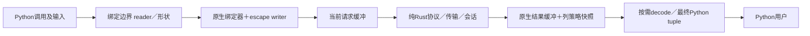

# SQLAero Rust sync内核：72小时执行与验收计划

状态：持续推进；P01及P02原生连接闭环通过，P03全部通过，继续P04.1结果容量与拥有关系。原正式T0为2026-10-26T01:09:55+08:00，排除暂停1分56秒；动态余额见第9节，产品验收43／100分。本文是本项目唯一执行计划及推进台账。

## 1. 执行依据与核心instruction

按[AGENTS.md](../../AGENTS.md)及[D01–D13规格定稿](../../docs/connection-reconstruction-research.md)实施；首版范围与延期能力见[范围索引](../../docs/首版不纳入功能清单-D01-D12.md)，C01／C02和A01–A08已批准，见[集中授权](../../docs/定稿复核与集中授权.md)。本文落实工程顺序、预算和证据，不另定义一套公共接口或修改规格中的数值。最新用户明确指令优先，真实契约冲突先说明，不能自行降标。

**执行时必须落实：**

1. **先可用、再优化，始终围绕一个当前最佳。** 先完成全部已定首版功能并建立B0；之后一次定位一个实测热点、验证一个具体假设。小范围定向验证后及时采用或撤回，保留回退；不留下许多未决候选代替交付。工作版本的局部通过与最终整体验收分别标明。
2. **时间用于产品成果。** 复用已定接口、成熟组件、experimental的有效reader／writer经验和构建缓存。旧性能runner已经删除，只写完成当前采集所需的最小入口；不恢复旧工具群、不为未来需求搭框架。不改无关正确实现，不以补丁不断叠加错误结构。
3. **安全、精度和拥有关系先满足。** Python只在输入适配、已批准协议及最终对象／异常边界出现；纯Rust核心不持有Python对象或调用Python。直接写当前Rust请求，结果原生保存、按需物化。必要复制允许，不为零复制跨越失效、可重入或GIL边界。
4. **保护参照不能滚动放松。** escape另与冻结v23比较；完整新API及迭代保护以同一B0为锚。可靠目标改善不足5%时逐项保护≤1%，可靠达到5%时≤5%；精度不变。必要未明不能当持平，超界不自动合并，必须给逐项数据和明确建议。
5. **循环补缺，不因一次干扰重跑整轮。** 一个完整配对组是提交／重试单位，保留全部合格快慢样本。有限恢复有假设、固定问题集和成本；局部停止只停止对应配置／候选，仍判断其他有据、获准且装得下的下一动作。
6. **每30个有效经过分钟自查、纠偏并汇报。** 对照目标、真实成果、当前动作价值和剩余验收／交付成本，作继续、换方法或停止无效路线的决定；超时、同因重复失败或新风险即时检查。不是例行审批，也不只汇报测试数量。
7. **72小时是硬约束。** 正式启动后所有实施相关工作及正常等待计时；阶段软目标可调配，修复余量转入具体步骤，不重复记余额。用户明确暂停以及无独立工作可推进的必要等待单列排除。续接不重置T0或已有证据；剩余预算不自动扩成新功能。
8. **主窗口自主执行、核对和记录。** 本轮不开子agent、不恢复旧任务、不更新Page。A01–A08已批准，不反复索取普通安装、测试、有限恢复和发布许可；实际登录／系统权限、安全或范围／验收实质变化、预算不足才集中报告。最终tag已委托主窗口，不再加第二次人工发布确认。

直接适用的skill：[Budget](/Users/jef/.codex/skills/budgeted-project-planning/SKILL.md)、[Noise](/Users/jef/.codex/skills/noise-resilient-benchmarking/SKILL.md)、[Rust](/Users/jef/.codex/skills/rust-best-practices/SKILL.md)。执行规则以本仓库和用户已定契约为先；skill提供预算、采集及Rust实现方法，不引入额外审批、强制多agent或无关测试矩阵。

## 2. 本次必须交付什么

交付完整可用的sync MySQL客户端：安全建连→参数化SQL及批量分块→原生结果→tuple读取→会话／事务／错误／独立retry→实际安装与发行。公开接口、12类精确标量及list／tuple、编码、TLS四模式、七个decode选项、Columns／ColumnInfo、错误树和超时均按对应规格，不因本计划只列代表场景而缩减。

首版实际验收目标：MySQL 8.4／9.7两条线、macOS arm64、常规GIL版CPython 3.12／3.13／3.14／3.15；同源四个wheel及一份sdist，GitHub Actions构建／检查后首次GitHub Release及PyPI alpha发行，并核验已发行安装包。async、free-threaded、Windows／Linux／Intel等仍是已记录的后续目标，架构保留路径，本轮不提前声明支持。

完成须同时满足：

- 已定必要功能、安全、值／异常契约和各必要保护场景有有效证据，公开类型／英文文档与真实行为一致。
- B0完整、可回退；采用的优化有可靠收益及适用保护，最终同一组合必要性能结论明确。没有收益时如实交代，不以增加复杂特例换微小或未证实收益。
- 最终源码、Cargo.lock、构建参数、实际产物、版本、说明和证据对应；四版实际安装及必要集成通过，sdist可按已定条件构建。
- 已授权的发行真正成功，发布包安装核验完成。必要门槛未过就保留未完成状态，不能用alpha标识、文档完成率或100分代替。

## 3. 起点事实与工程接线

### 3.1 已核实起点，不重复开发

截至本次收口，只做了文档／来源／权限元数据及工具身份核查，没有新驱动构建、数据库运行或性能采集。

| 对象 | 当前事实 | 执行含义 |
| --- | --- | --- |
| 仓库 | 本地main，origin为AresJef/SQLAero；根目录保留AGENTS、LICENSE、docs、experimental、reference | 不恢复用户已删除旧产品；实施先核未提交修改，按A05建codex/任务分支 |
| 冻结速度参照 | experimental/rust/list_rust.so，SHA-256 `6d7ede93b2bf6cbd8eaee42a9aa89dcc5092a3bf69378a95b37f718ec155fb30` | 用真实专用入口及新采集数据；旧汇总不是本轮成绩，不把重编译产物冒充原v23 |
| 可复用SDK | experimental/.runtime/rust-1.99.0/bin中的rustc／cargo能读到1.99.0；保留CPython能读到3.13.3 | 二进制及冻结环境只读复用；新缓存、venv、target独立，不source会改写旧缓存的activate.sh来构建新产品 |
| 本机 | macOS 27.0.1 arm64，CLT clang存在；普通PATH未配置本项目Rust／Maturin／Pyright | 不以PATH缺项判全部环境不存在；新工具实际安装和构建归P01 |
| GitHub | 当前连接账号AresJef，目标仓库返回admin／maintain／push等权限；仓库auto-merge关闭 | 元数据不是写入／发行证明；按获准PR流程主动合并，不为此开启仓库自动合并或关闭保护 |
| PyPI | 目标是既有SQLAero／sqlaero，当前alpha候选0.2.0a1 | 实际登录、Trusted Publisher及版本可用性在P01提前核对，缺口尽早一次说明；不获取明文token |

### 3.2 选定组合和边界

既定组件见D13-Q08–Q14。下表补齐执行接线，版本变动必须有具体兼容／构建证据并按既定依赖政策处理，不能随意追latest。

| 职责 | 采用组合 | 实施核对点 |
| --- | --- | --- |
| Rust | 固定稳定Rust **1.99.1**，edition 2024；首版rust-version同一工具链 | 依据[官方发布记录](https://doc.rust-lang.org/releases.html)，1.99.1修复macOS链接及其他问题；P01取得实际工具并构建验证，当前不称已安装 |
| Python边界／JSON | PyO3 0.29.2，jiter 0.17.0的python／num-bigint | 只进入绑定crate；不混用另一PyO3 FFI，不开abi3／abi3t；JSON只解析一次，完整数值和资源契约实测 |
| MySQL公开协议／认证 | mysql_common 0.38.2；最少feature，flate2 1.1.10的rust_backend统一后端 | 不引入完整驱动，不强制通用Value／Row树；禁止组件裸TCP自动取服务器公钥分支；未协商压缩不等于依赖图没有压缩代码 |
| 原生同步I/O | **Mio 1.2.4**，default-features=false，os-poll／net；socket2 0.6.5处理适用socket选项 | 复用跨平台connect／就绪等待，不自写各OS轮询后端；见[Mio固定清单](https://github.com/tokio-rs/mio/blob/v1.2.4/Cargo.toml)。不是Tokio运行时，不增加后台工作线程 |
| TLS／系统信任 | rustls 0.23.46＋aws-lc-rs 1.18.0；rustls-platform-verifier 0.7.1；Apple薄适配security-framework 3.7.0 | 四模式、显式CA替换、VERIFY_CA不验名、REQUIRED仍验握手签名；不把extra_roots追加当替换。只在传输／信任边界作必要平台适配 |
| 密钥／秘密 | rustls-pki-types 1.15.1、pkcs8 0.11.0、zeroize 1.9.1 | PBES2现代算法及配对验证；RSA认证复用aws-lc公开接口，不接第二套RSA，不声称清除了用户Python字符串 |
| 字符集 | UTF-8原生；encoding_rs 0.8.42无替换接口；必要MySQL专用原生表／算法 | 先完成下节逐编码路线，禁止Python codec、OS iconv、Web别名直接冒充MySQL映射或运行时猜编码 |
| Python／构建工具 | 主开发和v23对照用保留CPython 3.13.3的独立venv；四版交付通过同源CI矩阵落实 | P01一次解析并记录每个解释器实际修补版、Maturin和Pyright官方稳定兼容版本及安装身份，锁定之后不漂移；不要求本机先全装四个解释器才能开发 |

Cargo.lock保存完整传递图；检查实际feature统一、重复FFI、C／汇编构建要求、来源／许可。最终release采用已定opt-level=3、thin LTO、codegen-units=1、panic=unwind，不用target-cpu=native；长度／偏移／容量用受检运算。工具及Action固定版本／提交身份，在P01最小通路得到实际证据后冻结，不把当前清单当构建成功。

最低macOS要区分**构建部署下限**与**实际运行验证范围**。现有静态依据支持从arm64的11.0候选下限核查，但不能仅凭链接标签宣布11.0已运行通过；[当前官方runner列表](https://docs.github.com/en/actions/reference/runners/github-hosted-runners)提供的arm64环境与本机版本分别记录。P01根据完整依赖／SDK／实际可用验证环境确定准确声明，不增加旧系统兼容分支；真实能力与已定交付政策冲突时早报，不到发布时隐藏。

### 3.3 编码与初始化的确定路线

按[MySQL 8.4字符集目录](https://dev.mysql.com/doc/refman/8.4/en/charset-charsets.html)，排除已定utf8mb3及不能作客户端编码的ucs2／utf16／utf16le／utf32后，有36个客户端编码家族；P01还须与9.7真实目录核对并集、collation及ID，不能用8.4网页替代两线验证。

| 家族 | 本计划的处理路线 |
| --- | --- |
| utf8mb4 | 原生UTF-8校验／编码／写入，ASCII连续段直接处理 |
| ascii、binary | 按MySQL语义直接处理及严格边界校验，不走Web标签替换 |
| armscii8、cp1250／1251／1256／1257、cp850／852／866、dec8、geostd8、greek、hebrew、hp8、keybcs2、koi8r／koi8u、latin1／2／5／7、macce、macroman、swe7、tis620 | 单字节路由：以MySQL规定映射为准；与encoding_rs实际双向映射完全匹配则选该组件，否则采用集中原生表，不按名称近似替换 |
| big5、cp932、eucjpms、euckr、gb18030、gb2312、gbk、sjis、ujis | 分别核对有效序列和双向映射，匹配部分用encoding_rs，差异在同一codec内用明确表／算法；不是失败后再试其他编码 |

P01.2的产物是一张**逐个编码的唯一静态路由表**：目录身份、实际实现、映射数据来源／许可、失败定位及必要验证集合。此时可以未实现全部转换，但不能留“实施时随便选”后进入依赖它的工作。P03／P04完成实际双向核验；不能用同一生成器产生所有预期自证正确。

保留MySQL特有映射，例如latin1并非直接套Python latin1。映射数据优先使用许可适用且核对匹配的公开标准数据；不将MySQL的GPL代码／表未经许可判断直接复制进MIT产品。完整数据来源和许可证随产物保留；实际冲突才交用户，不增设逐条许可审批。

握手响应的[character_set字段只有一字节](https://dev.mysql.com/doc/dev/mysql-server/latest/page_protocol_connection_phase_packets_protocol_handshake_response.html)。工程采用已知utf8mb4握手上下文，按该实际上下文编码握手字段；认证后用安全的内部SET切到用户要求的完整charset／collation及会话策略，不能截断大于255的collation ID。把可合并的UTC、autocommit、跟踪和已传服务端超时尽量合成一次[多变量SET](https://dev.mysql.com/doc/refman/8.4/en/set-variable.html)，再取必要初始确认值；不是开启用户多语句。SET内容使用同一安全编码基础及已校验目录，不为初始化另写不安全字符串拼接器。

### 3.4 模块归属与数据交接

两个crate及Python布局沿D13-Q07，不为每个功能另建crate。核心内部按真实内容组织config／charset、protocol、transport／tls、session、bind／escape、result／decode、error；绑定crate承担精确reader、批准的PathLike／tzinfo协议、最终Python值与异常。模块之间传原生值、安全视图、拥有的请求／结果及明确范围，不传通用Python对象树。



reader增量驱动绑定器，不向核心注入“读取下一Python行”的回调；网络前当前请求完全原生拥有，再释放GIL。借用Python存储时不释放GIL或回调；可重入协议先结束可冲突借用。下一块恢复绑定阶段，同一connection的命令执行权保持正确，Cursor自己的缓冲读取独立保护。就绪等待和截止交传输适配，按既定边界响应Python中断，不用逐值GIL切换或另建通用动作调度框架。

## 4. 72小时分步实施与固定验收权重

合计62小时工作＋10小时修复余量。下表中的时间是目标分配，完成即进入下一必要步骤，不需要耗满；通常单步不超过2小时。模块文档、类型和相称测试计入该步，不留待最后集中补写。

**计分只认有效验收证据。** 下表必要分值合计100；未开始／进行中／待验／受阻不计通过分，失效只撤回受影响项。阶段只汇总，不重复计分；分值不代表工时或成功概率。P07前四项的分数是有据评估及采用／保留决定，不要求捏造收益；最后一项可选迁移为0分，不能稀释必要验收。

表内“未开始／—”为初始状态／实际用时，实施时原位更新。依赖指能力依赖，基础错误、状态和拥有关系随最早调用落地，P05负责完整闭合，不等待P05才有安全报错。

| 步骤 | 预算 | 依赖 | 交付物与该步通过证据 | 分 | 状态／实际 |
| --- | ---: | --- | --- | ---: | --- |
| P01.1 最小安装通路 | 1h | 正式启动 | codex/分支、独立工具环境、双crate与Maturin最小真实import；提前核GitHub／PyPI和CI权限，固定工具身份 | 2 | 通过／与读取及P01.2交错，合并活动区间见第9节 |
| P01.2 依赖及高风险接线 | 1.5h | P01.1 | Cargo.lock／feature／许可、36编码及两线目录路线；TLS特殊政策／密钥、jiter及异常构造最小公开接口验证；未决实质阻碍提前报告 | 3 | 通过／接口定向检查、锁与许可、36编码静态路线及两线实际目录已取得 |
| P01.3 专用MySQL环境 | 1.5h | P01.1 | 两线实际程序身份、独立数据／端口／socket／证书／账号，可重建并取得最小连接证据；无业务DB或系统默认变动 | 3 | 通过／两版本TCP、Unix、TLS验名与受控重启后数据保留已实际验证 |
| P02.1 协议与资源边界 | 2h | P01.2 | 握手／OK／ERR／EOF及包序号、分帧／长度、收发限额、基础原生错误；截断／恶意长度用离线片段定向验证 | 3 | 通过／受检分帧、序号、限额及OK／ERR／EOF定向测试；两版本实际握手通过 |
| P02.2 传输及截止 | 2h | P02.1 | Mio TCP／Unix、短读写／中断／就绪等待、连接及操作截止、命令执行权；真实I/O和可控故障验证 | 3 | 通过／可恢复短I/O、实际读超时、两通道及跨线程立即Busy；证据session-unit.log、transport-real-greetings.log、session-real.log |
| P02.3 认证及安全材料 | 2h | P02.2、P01.3 | caching_sha2快／完整／切换及最终OK；TLS／Unix安全通道或可信本地RSA；PEM／PKCS#8及配对，拒绝自动取钥 | 4 | 通过／两线真实冷／热／本地可信RSA、密码错误；AuthSwitch及最终OK定向；PKCS#8／PKCS#1／SEC1、AES三宽度与SHA2／scrypt实测，见establish-real.log、key-formats-real.log |
| P02.4 TLS四模式 | 2h | P02.3 | 系统信任／显式根替换、验名／不验名／REQUIRED签名、TLS版本及客户端证书；正反证书场景与两通道适用组合 | 4 | 通过／两线真实四策略、TLS1.2／1.3、错误CA／名称及加密客户端证书；OS系统信任真实握手通过，见establish-real.log、system-trust-real.log |
| P02.5 Ready与关闭闭环 | 2h | P02.4 | 初始化尽量合并、实际状态确认、无降级／秘密泄露；connect→SQL→close最小闭环，两服务器各运行 | 4 | 通过／两线六编码初始化实际读回；两通道查询、正常COM_QUIT及关闭后事实有效。纯Rust闭环，Python公开驱动仍待后续接入 |
| P03.1 数值及时间reader | 2h | P02.5 | 精确标量、整数／Decimal精度、非有限NULL、负零、UTC及安全时长；共享原生writer、值／异常边界 | 5 | 通过／43项reader定向、全部Python70项／Pyright／Clippy通过；两MySQL线实际DOUBLE极值与NEWDECIMAL类别、值一致。私有请求探针使用同一reader／writer |
| P03.2 文本与二进制 | 2h | P03.1、P01.2 | str／bytes／bytearray、融合编码／转义、二进制CAST、两SQL模式、完整编码发送路径及定位 | 5 | 通过／全部36编码×两SQL模式×两MySQL线实际通过；完整单字节及354407多字节观察／独立PSF／全Unicode核对通过，106项Python及Pyright／Clippy通过。输出宽容物化仍归P04 |
| P03.3 形状及位置绑定 | 2h | P03.2 | list／tuple、many／itemize、循环／层数、空根集合、%s／%%、引号及注释；准确原生SQL与无注入歧义 | 4 | 通过／138项Python、27项核心及类型／Clippy通过；两线真实参数数据隔离、36编码各9144注释字节观察和LF／CR语义通过。按256KiB返回边界，长值截止及信号实测通过 |
| P03.4 合并及真实分块 | 2h | P03.3 | 同范围Rust扫描器／编译regex公平小测后只留胜者；批准语句合并／回退、编码后真实字节限额、完整行切分及失败前缀 | 3 | 通过／原生扫描保留，完整行真实字节拆分；148项Python、31项核心及两线真实SQL通过；失败前缀只取实际响应。证据startup/batch-contracts.json |
| P04.1 原生结果 | 2h | P03.4 | 列／行范围及拥有者、buffered响应、单结果／连接聚合容量、资源释放；基本tuple fetch及多Cursor结果独立 | 5 | 未开始／— |
| P04.2 decode及读取原子性 | 2h | P04.1 | 全MySQL结果类型、七选项、jiter一次解析、严格／宽容文本与日期、TIME；失败不推进读取位置，完整接收解码路线 | 5 | 未开始／— |
| P04.3 Columns与缓存 | 2h | P04.2 | 29字段、names／keys及重复规则、PEP description、按需Python缓存／旧元信息快照；新执行及未执行／关闭状态 | 4 | 未开始／— |
| P05.1 会话与事务 | 2h | P04.3 | 统一响应状态路径、必要最小确认、UTC失效、手动事务及隐式提交、context manager及未知执行事实 | 4 | 未开始／— |
| P05.2 完整错误目录 | 2h | P02.1、P04.2 | 两线协议ERR完整分类、独立来源核对、11异常及Warning、两公开IntEnum同源生成、未知SQLSTATE回退及只读构造契约 | 4 | 未开始／— |
| P05.3 单主错与诊断 | 2h | P05.1、P05.2 | ErrorInfo全部字段、cause／context／additional_errors、延迟快照刷新；业务／提交／回滚／清理的单主错优先级与未知计数 | 4 | 未开始／— |
| P05.4 retry及配置闭合 | 2h | P05.3 | RetryRule／decorator／block、AND／OR及次数等待、ParamSpec保真；八超时、local属性／remote方法、关闭后读取／修改约定 | 3 | 未开始／— |
| P06.1 完整功能B0候选 | 2h | P05.4 | 第5节必要覆盖在两服务器落实；真实包调用、码目录／英文文档／类型／资源证据；功能缺口关闭后冻结B0候选 | 3 | 未开始／— |
| P06.2 校准／预试／冻结 | 2h | P06.1 | 一个最小采集入口、完整保存读回、共同n／真实周期／质量／CI及成本；有界预试证明全矩阵及交付装得下 | 2 | 未开始／— |
| P06.3 v23起点位置 | 2h | P06.2 | 相同输入／值／工作量的release escape配对；四档及适用分支，报告边界区别、逐项耗时／倍率／区间 | 3 | 未开始／— |
| P06.4 自身API基线 | 2h | P06.3 | connect／execute／batch／fetch／decode等实际API起点、固定输入与B0源码／产物；可恢复数据、必要回退及热点排序 | 2 | 未开始／— |
| P07.1 原生读写热点 | 2h | P06.4 | 依据实测选择reader／writer慢点，小改动、定向验证、保护及采用／保留决定 | 1 | 未开始／— |
| P07.2 同类型批量路径 | 2h | P07.1 | 有证据才迁移紧凑读取／固定宽度／连续写入经验；同输入逐项判，不能识别基准或缓存答案 | 1 | 未开始／— |
| P07.3 绑定及请求复用 | 2h | P07.2 | 实测定位扫描、合并、容量／发送成本后选最高价值点；无足够价值则保留正确直接路径 | 1 | 未开始／— |
| P07.4 decode／物化热点 | 2h | P07.3 | 依据B0及现有结果定位高成本转换／最终对象；保护值及Cursor语义，明确收益／代价和决定 | 1 | 未开始／— |
| P07.5 迁移与组合收敛 | 2h | P07.4 | 只在有源码依据且预算可容纳时迁移已证方法；否则提前进入P08；冻结一个当前最佳并清除本轮被替代生产路径 | 0 | 未开始／— |
| P08.1 最终功能／安全 | 2h | 当前最佳冻结 | 同一最终组合两线集成、必要故障／资源、fmt／Clippy／类型／文档及许可证；未受影响模块证据直接复用 | 4 | 未开始／— |
| P08.2 最终性能保护 | 2h | P08.1、P06 | 最终组合对B0的必要保护＋对v23位置；目标／风险独立复现、固定问题集恢复，逐项结论及全部代价 | 4 | 未开始／— |
| P08.3 实际分发验收 | 2h | P08.2 | 四CPython wheel＋sdist、隔离安装／核心集成／类型；CI实际构建链及待发布清单、最终说明 | 3 | 未开始／— |
| P08.4 首发与交付 | 2h | 发布前必要门槛通过 | 获准分支／PR合并、主窗口推tag、Actions检查后GitHub／PyPI发布、同版本安装核验；报告及专用实例收尾 | 3 | 未开始／— |
| R 已观察缺口修复 | 10h | 具体证据及完整成本 | 按实际需要转入上述步骤；记录来源／用时／余额，不预建额外系统、不重复占额 | — | 未分配／— |

P01=4h、P02=10h、P03=8h、P04=6h、P05=8h、P06=8h、P07=10h、P08=8h，共62h；阶段分值依次8／18／17／14／15／10／4／14，总100。

阶段交接是成果检查，不新增用户审批。P03首次实际escape可用即做能改变实现的小测，不等P06才发现明显低效；P06才形成正式完整B0及采样冻结。P07主题可按真实热点在自身额度内重排，无价值路径不硬做；不能用此跨过功能基线或删掉P08必要交付。

**每步开工的预算检查：** 下一动作的实现＋构建＋定向检查＋受影响保护＋可能撤回／保存成本，加上其他剩余必要功能、按实测更新的P08剩余工作及具体必要修复，必须不大于实际余额。P08初始预留8小时，不因编码／可选优化超时而默删；若实际成本更高，优先从R或未启动的可选优化额度调配。累计工作目标为P05结束36小时、P06结束44小时、P07结束54小时、P08结束62小时；这些是预测检查点，10小时R按真实缺口有据使用，不是允许忽略到第72小时才发现验收来不及。

## 5. 必要验证覆盖与方法

每个功能用“规格题号／分支→具体输入与预期→实际调用→证据”定位，清单由同一测试／场景配置维护，不逐句规格机械生成测试。两服务器各验证公共核心行为，版本特有分支在对应版本补齐；不是把所有参数笛卡尔积。下表是必须覆盖的分支索引，不是虚构已通过项或预定测试总数。

| 规格归属 | 必要代表分支及验收方式 |
| --- | --- |
| D01／D02 接口 | 31项connect参数及keyword-only、args缺省／None、严格bool、别名、tuple fetch、Cursor／transaction选择器；运行与.pyi一致 |
| D03／D04 数据流 | core依赖图无Python、网络阶段原生拥有、可重入前结束借用、缓冲扩容／旧视图、多Cursor结果独立、Busy立即返回；定向并发及生命周期场景 |
| D05 连接／编码／额度 | TCP／Unix及冲突，str／Path／PathLike三形式，size统一解析／溢出，全部charset／collation的目录及双向路由、真实字节包长／结果容量边界；适用两线往返与非法序列 |
| D06 TLS／认证 | 四模式默认及正反验名、系统／显式根、Unix TLS、TLS1.2／1.3、证书密钥配对／现代加密PKCS#8、快／完整／切换认证及最终ERR，可信本地RSA和禁自动取钥；错误不泄密 |
| D07 escape | 12精确标量及拒绝子类／其他类型，NULL／非有限／负零／极值，Decimal精度，文本特殊字符及两SQL模式，多字节反斜杠边界，bytes／bytearray，UTC与tzinfo批准协议，负／极大时长，list／tuple嵌套／循环／层数／共享非循环 |
| D08 绑定与批量 | 保护区域／%s／%%／命名拒绝、引号／注释／特殊注释、many／itemize与空集合；全部批准INSERT／REPLACE形式、回退及完整行切分，错误发生在发送前／后／确认前缀，计数未知和真实执行事实 |
| D09 结果 | 全部字段映射、NULL、SET／JSON／BIT、Decimal／float、严格／宽容文本与日期、微秒／TIME；七开关快照，fetch失败原子性／耗尽；29字段、重复key与用户AS混合、旧Columns和Python缓存 |
| D10 会话／事务 | UTC默认与失效检查、autocommit／事务状态、raw SQL引发状态变化及必要确认、隐式提交、多Cursor、手动控制和context退出，未知提交不能自动重放 |
| D11 错误／超时／retry | 两线完整码映射与两枚举、SQLSTATE回退、11类／Warning和标准异常不改写、单主错及ErrorInfo新快照；四本地／四服务端超时、截止不重置、远端属性确认；retry按主异常类型／code、AND／OR、次数／无限／等待、无异常历史膨胀 |
| D12／D13 交付 | v23及B0对照、必要保护、同源release、四版实际wheel安装、sdist重建、类型及英文文档、真实Actions／PyPI链路；延期能力明确不宣称已支持 |

错误码目录单一人工维护源采用简单声明数据，轻量生成Rust分类、两套Python IntEnum、.pyi及可读清单；无需运行时下载／生成。全量静态核对包含两线协议ERR适用集合及共享码的独立来源，代表真实ERR核对运行接线；不为每个编号制造服务器故障，也不直接复制受限的完整消息文本。

Rust验证使用实际支持feature的cargo test、cargo fmt --check、Clippy及适用doc检查；不盲开all-features或安装nightly格式化。预期错误走Result，unsafe必须有必要性和清晰英文SAFETY契约；高风险改动针对真实可达输入验证，不为假设风险无限加测。Python源码完整type annotation，公共.pyi及英文docstring覆盖含义、单位／默认、来源、I/O副作用、错误、缓存及生效边界；retry装饰后保持参数／返回类型。Pyright是唯一主类型检查器。

## 6. 轻量且可恢复的性能采集

### 6.1 比较对象、边界与场景

两种问题分别报告：**v23说明escape速度位置**，**B0说明本项目优化及保护**。不把两者时间或倍率串乘，也不将新内核的Rust请求强行转换成Python SQL字符串以制造相同返回类型。

- v23：真实冻结入口，完整Python调用及其原有输出；新版：私有测量接线调用实际reader／writer／请求完成路径并消费结果，不能另写快算法、仅测内部整数formatter或删除必要检查。该接线不是公共escape API，使用同一release源码及配置，明确最终输出边界差异、PyO3／编译身份和未可同值比较项。
- B0：冻结完整可用源码、依赖、输入、输出和实际API。候选既报相对上一当前最佳增量，也做B0锚定保护；不能逐轮接受5%累计绕过。
- 适用规模为1／100／1000／10000。标量按自身内容规模，容器按元素数，结果按行／列；不能把标量机械复制成另一任务冒充规模覆盖。具体ID及适用性在P06正式前冻结。

| 场景族与ID前缀 | 输入／任务与计时边界 |
| --- | --- |
| `escape/<type>/<variant>/<shape>/<mode>/N...` | 精确标量、同值／不同值list／tuple、已定mixed及嵌套，必要特殊字符／精度／非有限／两SQL模式；同输入同任务，准备输入在外，完整目标调用在内 |
| `bind/<syntax>/<shape>/N...` | %s数量、保护区域、批准合并语句及回退，escape与实际绑定到原生请求完整计时，不跳过扫描或限额 |
| `execute/<server>/<transport>/<query>/R...C...` | 相同SQL、相同表状态／参数／事务／TLS；网络、服务端正常工作及必要缓冲全部计时 |
| `fetch/<schema>/<method>/R...C...` | 原生结果准备后计实际fetch、decode与最终Python对象；耗尽Cursor不能复用作新样本，无公开重置API |
| `connect/<server>/<transport>/<tls>/<auth>` | 每次真实新连接到Ready；区分认证缓存／完整认证，双方一致前置条件，正常握手／初始化全部计时 |

写入／事务场景前置数据重置对称且在目标调用外；每次结果和副作用核对不混进计时。耗时足够的网络任务优先n=1，不为凑批次制造大量数据库状态。确需短fetch批量时，在计时外准备有限且状态一致的Cursor池，每个仅消费一次；记录准备成本／内存，不能把重置隐藏在循环里或重测空结果。

v23与新模块身份不同，先验证可在同PID合法加载；B0／候选默认用两个实际worker各装对应包路径，协调器按AB／BA紧邻、串行执行完整调用，IPC在目标计时外，避免同名PyO3模块／全局类型交叉加载。worker不是子agent。真实worker进程周期、完整输入预载、加载顺序及预热一并冻结；后续不随意换上下文再拼数据。

### 6.2 P06校准与冻结表

只采用一个采集入口和数据配置，Python标准时钟／resource及现有开发NumPy承担计时、必要观察和统计；NumPy不进入产品运行依赖。运行原始数据与配置按身份分开，不复制v2／repair／final测量程序。

下列是**预试起点和允许搜索范围**，不是已经测得或已经冻结的运行参数。P06先用最小完整单元验证调用、实际加载、保存／读回、汇总及失败收尾，再预试代表最快／最慢／易波动场景，测实际总成本后一次冻结。

| 项目 | 预试与正式规则 |
| --- | --- |
| 时钟 | perf_counter_ns及thread_time_ns；读取实际resolution／成本及前后覆盖跨度，纳秒单位不等于纳秒精度，不从目标时间扣空循环成本 |
| CPU短批 | 双方共同n；以较快方约2ms为初试，允许目标1／2／5／10／20ms，确有精度证据可到50ms；较慢方和完整组跨度同时核算，不能一边无限放大批长一边保留大量样本 |
| 样本层级 | 一次样本是n次完整调用的T及T/n；一组是一个场景双方完整配对；统计按真实进程周期成簇，n不是独立样本数 |
| 重复与顺序 | 初试12个真实周期，每周期AB和BA各一组，即24个有效配对／场景；必要时预先选择20或32周期。双方每位置配额相同，实际质量不足的原槽补缺 |
| 预热 | 每worker／场景少量完整调用，按达到缓存与稳定运行所需的实测最小值并设墙钟上限；时间计入预算。不得每组重复全量正确性、每轮长预热 |
| CPU质量代理 | 校准观测误差后用wall与线程CPU差识别明显off-CPU；预试h=10%，计入校准余量，保留有符号差。该数是质量代理而非性能保护；不能当作频率／核型证明 |
| 覆盖误差 | 单独记录读取边界经验余量和外层快照覆盖跨度，按1%／5%待判门槛核精度是否足够；经验高分位不是绝对上界。计数缺失／单位错为程序问题，不无限pass |
| 网络及真实等待 | 不用线程CPU占比筛除正常网络／服务端等待；自动GC开启，正常分配／GC成本保留，不按速度删慢值。组跨度用于识别失配／不可比较上下文，不用上限删除实现本身正常成本 |
| 区间 | 主值为全部合格配对倍率r的中位数；以真实周期为整簇重采样，保留簇内AB／BA，95%双侧percentile区间；初试20,000次、固定种子20261026，计时外用NumPy成熟运算。有限簇的近似覆盖及相关性如实评估，不能把n次调用作独立观测 |
| 充分性／复现 | 冻结周期数、主轮判定点与目标／风险独立复现集；区间整体在允许侧且重复有效即可明确，不强加旧r5统一低离散度。可信相反周期、方法不适用或跨门槛保留未明 |

P06产出实际冻结表，记录共同n、目标与实际批长、组跨度、预热、快照误差来源、质量规则、周期数／真实PID、独立集、固定判定点、统计方法及runner／环境／产物哈希。若预试表明预计完整采集＋必要恢复＋P08装不下，先减无效准备、复用未受影响证据或从R有据调配；不先开长轮再求延期，不降低质量或数量到没有充分性。

正式数据每场景输出：双方T/n、配对倍率中位数及95%区间、平均值／完整范围作补充、绝对节省／增加、覆盖、组质量、充分性／统计结论、性能判定。性能PASS／FAIL／INCONCLUSIVE与运行ERROR分列；收齐数量不是自动PASS。

### 6.3 持续采集和有限恢复

```text
读取已核验完整组、冻结身份、缺口与剩余预算
while 必要配额未完成:
    核算下一完整单元＋保存／必要收尾可装入余额
    选择缺口的原场景、顺序槽和真实周期
    暂时环境不合格：默认等待1秒，可有上限退避
    执行双方前快照 → n次完整调用计时 → 后快照
    程序／身份／接口错误：隔离并诊断，不算CPU干扰
    任一成员质量不足：整组不计，原槽回队
    全组合格：追加原始记录并定期保存状态，保留快慢值
    同因持续失败：停止该配置，用已有证据评估一个最小替代动作
收齐后集中做统计和逐项采用／保护判定
```

原始记录至少含场景／输入／实际输出身份、配置／产物／runner／环境、双方T／n及快照、角色／顺序／PID／周期、组跨度和质量判断。拒绝按**实际执行过的各方、位置和原因**计数，另留有限诊断例子；没有逐次保存的无效尝试不称“全部尝试记录”。追加原始JSONL、周期性checkpoint、停止时集中汇总即可，不建设尝试预留／占额服务。

恢复仍在A04及总预算内：先核批长／时钟边界、组跨度、进程上下文、预热、GC准备遗留或正常工作、工具成本和真实方向。可按上表范围调整共同n／批长／周期、对称顺序或必要准备；改变准备期GC须有因果证据，双方同样处理，自动GC和计时内GC保留。每次动作先写固定问题集、证据假设、配置变化、完整成本及退出条件，通常在下一30分钟纠偏点前取得“继续或否决”的新信息，不把该检查点设为项目硬截止。

新配置完整替换指定问题场景的双方、全部顺序及周期，更慢也采用，保留旧失败及身份；不同配置不拼一个统计批次。未受影响场景仅在代码／输入输出／环境／边界／目标及身份有效时复用；改公共代码不能借“局部复用”省掉实际保护。重复看区间并补到偶然PASS不允许；需要更多数据只能按预先冻结的判定／恢复路径执行，不能事后改方法。

原配置无新信息即停止，随后评估其他必要项或最小获准替代；只有用户暂停／结束、72小时到达、真正共同阻塞／必要授权缺失，或确实没有有据且装得下的获准路径，才停止项目。保存当前最佳及准确缺口，不以“次数用完／没有现成工具”直接结束全项目，也不无限扩展工具。

## 7. 优化采用与当前最佳机制

1. P06冻结**B0：完整、正确、可安装基线**，保存源码commit／工作树补充、Cargo.lock、配置、产物哈希和必要环境；v23保留独立参照身份。
2. 每次只开一个具体候选Cxx。登记实测慢点、复用经验、改动位置、预期价值、定向正确性／风险保护集、完整成本及停止条件；通常先用短小测决定是否值得进入正式定向验证。
3. 先排数据／精度／安全错误，再判断可靠收益。按D12公式：r=t_ref/t_new，g=1−1/r；目标区间下界≥1/0.95才进入5%保护档，否则有可靠正收益只用1%档。
4. 必要保护区间下界≥1/(1+d)才通过；上界小于该阈值是可信超界，横跨为未明。相对B0保护同时保留，不用无业务依据的平均分抵消某项代价。
5. 定向收益和必要受影响保护明确通过即进入一个**当前工作最佳Wxx**，保存原Wxx回退；全矩阵最终保护未完成就标待最终验收。公共dispatcher／布局／编译变化应扩大到真实受影响集及跨路径哨兵，不能把“定向”当忽略代价。
6. 无收益、不值得的复杂性或不可接受退步则撤回本轮该候选。若存在真实大收益但超界，保留证据、列明每项绝对／相对代价并给明确建议交用户，其他已获准工作继续。没有同意不能用A04采样授权接受性能代价。
7. 最终只交付同一已测组合及B0／必要回退；直接与v23重新对照受影响项，不乘历史倍率。功能缺陷必须修复，安全和精度不能交换；不是所有探索都必须产出新优化。

## 8. 运行、版本与发行的执行顺序

### 8.1 启动时与每次恢复

明确启动时先读本计划、AGENTS及相关规格／授权，核当前工作树和本项目进程，不恢复旧常驻agent。首次记录真实T0及下一30分钟纠偏时刻，保存起点身份后执行P01.1。之后使用独立`.venv`／工具目录、项目自己的Cargo缓存及target，不写experimental的target／cache；活动MySQL数据放非同步临时目录，秘密不进Git。

每次续接读第9节：核实际已用、暂停区间、当前步骤、工作最佳／回退及已提交完整组，检查仍属自己的进程／产物后直接续接缺口。不因新会话重复安装、重建或重测有效证据，不设置新的72小时。

### 8.2 构建和CI

P01先做可安装最小通路和一次可执行CI验证；必要workflow／Action版本及权限此时固定，避免最后才发现不可推送／无可用runner。开发在主CPython release重建，Rust变更后新进程核实际加载产物。不要为每个候选构建四个Python版本或清空缓存。

基础命令在布局落实后使用，当前未执行：

```sh
cargo test --workspace --locked
cargo fmt --all --check
cargo clippy --workspace --locked -- -D warnings
maturin develop --release --locked -m crates/sqlaero-python/Cargo.toml
pyright
```

所选PyO3扩展／测试链接确有feature需要时，在同一配置显式限定实际支持组合；不把不适用的测试命令强行运行到失败，也不借此跳过核心Rust和Python安装测试。真正构建命令、环境和工具路径随实际manifest冻结，上例不冒充已通过。

最终workflow矩阵只含首版arm64四个常规CPython版本，固定实际解释器修补版和构建工具；同一源码／锁／release参数，每个实际wheel在隔离环境安装、检查导出／类型／核心功能及必要两服务器集成。sdist列明必要源码、声明目录／派生表、许可和资源，实际从sdist重建一个代表wheel；不能把GitHub自动源码压缩包当已验sdist。最终四wheel及一sdist取回dist并核哈希，CI共享runner不承担正式性能判定。

本地与CI目标包保持同源配置及功能，正式性能证据只复用身份和影响有效的部分；对CI实际产物仍完成其必要安装和集成，不能把另一个二进制改名上传。测试环境用两条已核实MySQL线实际运行；Homebrew原生安装不启动brew services、不碰系统默认数据库，专用实例本地回环、短socket、独立账号及证书，控制进程前核自己的PID。

### 8.3 一次实际alpha发行

P01提前核PyPI项目／候选及OIDC配置，P08才发行。候选Python版本0.2.0a1，对应Rust语义版本按生态规范表达；占用时仅选同0.2.0线下一可用alpha并记录。发布说明放`docs/releases/<tag>.md`，逐项说明功能、支持矩阵、真实性能结论、限制和回退。

发布前必要验收和身份核对通过→按A06提交／推送明确产品文件及PR并关联→检查通过后合并main→主窗口按A08推一次新tag→Actions按tag重新核身份、构建／测试实际产物→全通过后GitHub pre-release及同批PyPI上传→从已发行包安装核验。tag push是唯一发布触发，不另用release published重复发行，不再等用户第二次确认。

只提交／发布新产品及必要资料，不用git add .上传experimental、reference、研究归档、运行证据或秘密；按明确范围替换旧产品／workflow，保留旧tag／Release和发行历史。必要Actions权限和PyPI Trusted Publishing限定到目标workflow，不创建长期token或付费资源。GitHub／PyPI部分成功要按真实状态记录，复用同一已验产物安全恢复剩余步骤；不可覆盖的版本／tag冲突不能靠改tag或另发实验版本绕过。

## 9. 唯一台账、恢复与交付

本节与第4节原位更新，不再新建项目进度／审批台账。原始数据、配置与简明报告放`evidence/rust-sync-kernel/<run-id>/`，机器checkpoint只存完整组及身份／缺口，不复制项目预算账；最终产物放dist。文件命名随实际创建登记，不现在造空目录或成功报告。

| 项目 | 当前值 |
| --- | --- |
| 正式T0／时区 | 2026-10-26T01:09:55+08:00／Asia/Shanghai |
| 正式已用／余额 | 截至05:49:08已用4小时37分17秒／余额67小时22分43秒；之后继续计时，暂停排除01:13:21–01:15:17共1分56秒 |
| 当前步骤／下一动作 | P04.1：复用既有原生响应，落实实际容量、暂态与连接聚合配额及结果拥有关系；两小时目标可装入余额，P08仍8小时、R仍10小时。下一自查06:11:51（T+300） |
| 已通过分值 | 43／100，P01／P02／P03全部通过；不是完整Python驱动或性能验收通过 |
| 当前最佳／回退 | P03.4源码／产物身份见startup/batch-contracts.json；回退P03.3本地cda6dd2，编码a0e1b38，数值／时间7499ffd，P02闭环c3cc2982ea8e；P01回退本地b0ac21a80，初始通路b9ca56a66／远端c6ff57e8。experimental v23及冻结reference原样保留 |
| 运行与进程 | 两套专用mysqld已运行：8.4 PID26479、9.7 PID26486，分别使用/tmp专用目录与13384／13397回环端口；无性能worker |
| 已批准事项 | C01／C02、A01–A08已确认；用户启动后补充“仅在本次项目推进和规定预算内，所有合理请求统一approve”。自主处理必要合理动作，既定安全／范围／精度／验收及72小时不放宽，平台实际能力另核 |
| 待取得证据 | P04及后续完整产品、性能、分发证据；P04还须完成实际容量／暂态／连接聚合配额，当前原生结果仅有逻辑大小边界。完整错误诊断及Python公开接口未完成 |
| 修复余量R | 未分配10小时，使用时转入相应步骤并减R |

正式启动后在此维护一张活动区间表：`实际开始／结束（含时区）｜步骤／用途｜合并有效时长｜成果／证据｜偏差及下一动作`。连续同类工作可合并，重叠不相加；无法归属的如实记，不一律称CPU等待。每次纠偏同步总已用、P08预测、R及下一完整单元成本；若无法可靠计时说明证据和缺口，不擅自重置。

| 实际区间（Asia/Shanghai） | 步骤／用途 | 有效时长 | 成果／证据及下一动作 |
| --- | --- | --- | --- |
| 2026-10-26 01:09:55–01:13:21 | P01.1，启动核查／独立工具准备 | 3分26秒 | 建立codex/rust-sync-kernel；保留227项已有删除及原未跟踪成果；下载五组件并与官方清单哈希一致；创建独立.venv，未创建产品源码／构建／启动数据库。证据见[启动身份](../../evidence/rust-sync-kernel/startup/environment.json) |
| 2026-10-26 01:13:21–01:15:17 | 用户暂停 | 排除1分56秒 | Goal暂停／重建期间仅安全保存；恢复沿原T0及余额 |
| 2026-10-26 01:15:17–01:40:50 | P01.1、规格接续、P01.2全图及P01.3包身份预检，区间交错合并 | 25分33秒 | 本地core单测2＋doctest1、Python安装测试2、Clippy／格式及Pyright通过；远端CI 40217436022成功，旧失败40216738947保留。全组合cargo check通过，Apple实际依赖130包无缺失许可声明；尚未完成完整许可材料／关键接口及编码验收 |
| 2026-10-26 01:40:50–02:05:14 | P01.2／P01.3收口及P02.1协议准备，重叠合并计时 | 24分24秒 | TLS实际fixture检查3项通过、JSON原生15项及异常根构造10项通过；完整锁与128第三方原始许可保存。两线41／286目录一致，所选36／177路线见charset-implementation-routes.md；双实例受控重启通过。P01本地b0ac21a80保存，未改冻结参考。P08仍预留8小时、R10小时未动用 |
| 2026-10-26 02:05:14–02:41:16 | P02.1及P02.2–P02.4必要组件，合并计时 | 36分02秒 | P02.1通过；Mio两版本TCP／Unix和受控读超时实测通过。15项核心单测通过，认证不自动取钥且等待最终OK，TLS四模式配置及原生通道已编译；实际认证／TLS／查询整链仍待核验。T+60及T+90均按时自查汇报；下一T+120为03:11:51，P08 8小时和R10小时保持。 |
| 2026-10-26 02:41:16–03:59:24 | P02原生连接、查询、初始化及关闭闭环，合并计时 | 1小时18分08秒 | 真实认证／四TLS策略／六编码初始化／两通道查询与关闭通过；core20单测、受控socket超时及Clippy通过。普通沙箱socket权限失败单列session-unit-sandbox.log，同用例获准权限通过。T+120于03:16:21、T+150约03:48:38才汇报，分别延后约4分30／6分47；已纠正前置推演和记录滞后，采用短实现—实测—保存循环。P08仍8小时、R10小时未动用。 |
| 2026-10-26 03:59:24–04:12:19 | P03.1数值／时间reader及P03.2最小编码观察 | 12分55秒 | P03.1通过并保存7499ffd，22项核心／70项Python、类型和Clippy通过；实际两线DOUBLE极值／NEWDECIMAL值与类别一致。T+180已自查汇报；下一04:41:51。单字节事实表由两线各6144观察生成且完全一致；P03.2仍未完成，不把生成表当全部codec通过。P08 8小时／R10小时保持。 |
| 2026-10-26 04:12:19–04:39:54 | P03.2文本／二进制及实际codec | 27分35秒 | P03.2通过并保存a0e1b38；全部36编码×两模式×两MySQL线真实通过，6144单字节／354407多字节观测、独立PSF及全Unicode核对通过；106项Python、Pyright及Clippy通过。GB18030按固定语法修正宽度归纳错误，未放宽验证或使用替换。 |
| 2026-10-26 04:39:54–05:25:31 | P03.3 SQL词法／增量行适配与绑定控制 | 0小时45分37秒 | P03.3通过：138项Python、27项核心及Pyright／Clippy；两线数据隔离和完整字节注释分类通过。修正非ASCII／NUL／DEL分类及LF与CR差异，原失败分别保留bind-comment-initial.log、matrix-before.log及cr-before.log。T+210／T+240已自查，下一05:41:51。P08仍8小时、R仍10小时。 |
| 2026-10-26 05:25:31–05:49:08 | P03.4批量识别与分块 | 0小时23分37秒 | P03.4通过：148项Python、31项核心、两线真实批量SQL及Pyright／Clippy通过。144个开发有效配对、1无效尝试，扫描保留；仅开发选型，不冒充B0正式性能验收。T+270已自查，P08仍8小时、R仍10小时。 |
| 2026-10-26 05:49:08起，进行中 | P04.1原生结果容量与拥有关系 | 未结算 | 下一完整单元：实际容量／暂态、连接聚合额度及原生结果释放；复用既有响应路径，不新建内存监控框架。 |

**当前恢复点：** P01／P02／P03通过，43／100分；当前P04.1。P03.4身份及已安装扩展哈希见startup/batch-contracts.json，原生扫描选型与原始小测见batch-recognition-choice.md／probe.log；148项Python、31项核心及两线真实SQL通过。私有_bind_sql只验证真实COM_QUERY组装，公开Connection／Cursor及整次执行尚未实现，不把探针当完整驱动验收。批量使用同词法源范围、完整行硬上限、可复用有界原生行片段；失败前缀只取完整实际响应，实际会话上下文更新、发送切换和异常发布继续在P05接通。内部组批软目标未调优，暂用硬限额，P06／P07按实测再定。P03.3词法与长值控制见binding-contracts.json，LF结束行注释、孤立CR保留；36编码实际映射与严格路由见text-contracts.json及charset事实目录，旧错误测试／失败证据保留。P02原生连接／TLS／认证／初始化／查询／关闭已实测，相关session、initialize、establish、key-formats及query日志保持有效。P04.1必须替换目前仅逻辑大小的结果边界为实际容量／暂态及连接聚合配额，并解决收集器逐行reserve_exact增长；完整ErrorInfo和错误目录仍待P05，JSON私有ValueError也待正式接入DataError。两套专用数据库位于/private/tmp/sqlaero-mysql-501，秘密只在私有目录；source .runtime/env.sh后沿用独立target／venv，不修改冻结experimental／reference。PyPI已登录，release.yml／pypi发布者与无额外人工环境门禁已确认；最终发行仍待完整验收。

暂停／产品限制／安全退出时，在同一表保存：准确有效余额、已排除区间、当前代码／配置／产物及回退、测试／采集完整提交点、仍在运行的自己进程处理、缺口和下一条具体动作。保留已完成数据，不把中断运行返回成功；恢复从该点继续。只有用户明确暂停才将Goal设paused；整个目标实际达成才complete，不因局部失败或阶段预算耗尽结束。

最终简明报告放上述证据目录并在此链接，至少包含：实现／延期、当前最佳到B0及v23的清晰变化、逐项收益／代价／未明、功能／安全／完整错误目录／类型的覆盖、最终源码及包身份、构建复测命令、GitHub／PyPI实际结果、回退、实际用时与准确缺口。没有完成的项逐个写明，全部必要门槛通过才称项目验收。

## 10. 收口记录与启动方式

本轮只收口执行细节：主要整理及核对区间为2026-10-26T00:32:31+08:00至2026-10-26T01:08:43+08:00，有效经过36分12秒，无暂停；随后只保存结束记录并展示文件。不扣入尚未启动的正式72小时。已选接口及授权不重新开放，运行参数须P06真实校准／预试，源码及实际权限须对应步骤取得证据，不能现在宣称已经安装、构建或发布。

保存后的五份当前文档已读回，289处本地引用／锚点核对通过；32步预算为62小时，另保留R10小时，分值合计100。主规格455个显式锚点及范围索引91个唯一编号保留；AGENTS内容哈希与起点一致，十四条核心约束未重写。未运行新驱动测试或性能采集，冻结experimental／reference未修改，未执行GitHub写入／发布。

启动只需明确要求按本文实施，届时才登记T0和开启Goal；用本计划第9节持续恢复。可复制以下prompt，不必重新粘贴全部规格：

```text
/goal 启动并持续推进SQLAero Rust sync内核项目，工作目录：/Users/jef/ResilioSync/code/SQLAero。

完整读取AGENTS.md、tasks/rust-sync-kernel/plan.md、docs/connection-reconstruction-research.md及docs/定稿复核与集中授权.md，严格按最终规格和执行计划实施。C01／C02、A01–A08及由主窗口推送最终发布tag均已批准，不重复询问。

首次启动登记真实T0，总预算72个有效经过小时；若已有T0则按唯一台账恢复，暂停期间不计时，不重置余额。先完成可用功能基线，再深度优化，围绕一个当前最佳滚动采用并保留回退。严格快速优化、快速迭代，复用已有成果和最小工具，保持安全、精度、可维护性及既定1%／5%保护；不开子agent，不更新Page，不改动冻结参考。

每30个有效经过分钟自查、纠偏并汇报，持续推进到全部约定验收、已授权发行及安装核验完成。局部失败按计划有限恢复，不自动结束整个项目。遇真实硬阻塞、必要授权缺失、产品限制或总预算到达时安全保存当前最佳、证据、准确余额和恢复点，如实报告，不降标或默增预算。
```
